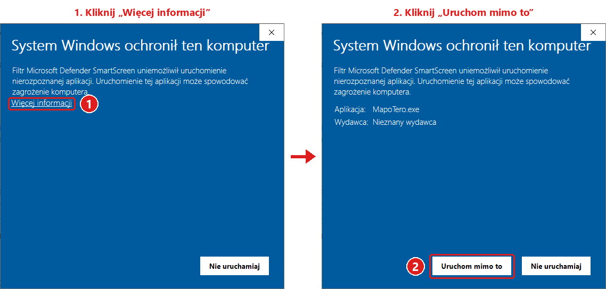

MapoTero 3.17 - drzewo warstw w grupach tematycznych, obsługa kafelków XYZ/TMS, wbudowany katalog publicznych usług mapowych i pełna pomoc online.

## Instalacja

1. Pobierz plik **[MapoTero_v3.17.zip](https://github.com/Eksploracja/MapoTero/releases/download/v3.17/MapoTero_v3.17.zip)** (bezpośrednie pobranie lub poniżej w sekcji *Assets*).
2. Przed rozpakowaniem kliknij plik prawym przyciskiem myszy, wybierz *Właściwości*, zaznacz **Odblokuj** i kliknij *OK* - wtedy Windows nie będzie blokował uruchomienia programu (program nie ma podpisu cyfrowego, więc filtr SmartScreen traktuje go jako nierozpoznaną aplikację; można też w oknie SmartScreen kliknąć *Więcej informacji* > *Uruchom mimo to*). Sumy kontrolne plików i wynik skanu antywirusowego - niżej, w sekcji *Sumy kontrolne SHA-256*.

   
3. Rozpakuj archiwum do dowolnego folderu i uruchom **MapoTero.exe** - program to jeden plik, obok którego musi leżeć folder `warstwy` (zbiory map).
4. Program wymaga środowiska [.NET Desktop Runtime 10 (x64)](https://dotnet.microsoft.com/download/dotnet/10.0) - jeśli nie jest zainstalowane, Windows zaproponuje jego pobranie przy pierwszym uruchomieniu.

Ustawienia i zbiory map z poprzednich wersji (plik `lastsettings.txt`, folder `warstwy`) są w pełni zgodne z wersją 3.17.

## Zmiany w wersji 3.17

* **Kreator dodawania serwerów – wbudowany katalog gotowych usług publicznych i rejestr EZiUDP:**
  * Okno kreatora otwiera się od razu na katalogu z listą ponad 100 sprawdzonych usług dodatkowych bez uciążliwych skorowidzów (m.in. archiwalne ortofotomapy GUGiK, BDOT10k/BDOO/TOPO, NMT cieniowanie i hipsometria, K-GESUT, osnowy podstawowe i specjalne, INSPIRE, hydrografia i zagrożenie powodziowe PGW Wody Polskie, osuwiska SOPO, jaskinie, złoża MIDAS i geologia PIG-PIB, mapy hałasu i pożary lasów Ekoportalu, IMGW, GUS oraz kafelki XYZ z katalogu NextGIS QMS: ESRI, Sentinel-2 2024, OpenTopoMap, CyclOSM, Freemap.sk).
  * Bezpośredni dostęp online do oficjalnego wykazu Geoportal.gov.pl oraz rejestru EZiUDP z wyszukiwarką usług powiatowych i gminnych po nazwie lub kodzie TERYT.
  * Opcja wpisania własnego adresu URL serwera WMS/WMTS/XYZ (przycisk pod listą lub wklejenie linku w polu wyszukiwania) oraz możliwość powrotu z podglądu warstw do katalogu.
  * Warstwy zapisane kreatorem zachowują w grupie *Dodane serwery* i na liście wybranych warstw swoje czytelne nazwy.
* **Obsługa kafelków XYZ / TMS:**
  * Bezpośrednie pobieranie map z serwerów kafli `{z}/{x}/{y}` i TMS (`{-y}`), w tym wbudowane zbiory *OSMapa.pl*, *UMP-pcPL* i przezroczyste nakładki szlaków turystycznych *Waymarked Trails* (piesze, rowerowe, MTB, konne, rolkowe, narciarskie).
  * Rozpoznawanie szablonów `{z}/{x}/{y}`, parametrów `{quadkey}` i `{r}`, metadanych TileJSON oraz specyfikacji `tilemapresource.xml`.
  * Podkład dodany po nakładce automatycznie trafia na spód stosu warstw, a pobieranie samych nakładek w pełni obsługuje przezroczyste tło PNG.
  * Ostrzeżenie przed pobieraniem obszaru leżącego w całości poza zasięgiem mapy, inteligentne zastępowanie brakujących kafli (HTTP 404) powiększonym fragmentem z niższego poziomu powiększenia oraz natychmiastowe zatrzymanie z podpowiedzią przy odmowie dostępu (HTTP 403).
* **Drzewo warstw w grupach tematycznych i wyszukiwarka:**
  * Zbiory map z folderu `warstwy` pogrupowane w czytelnym drzewie według definicji w `warstwy/katalog.txt`.
  * Szybka wyszukiwarka warstw i grup tematycznych w panelu map (niewrażliwa na wielkość liter i polskie znaki diakrytyczne).
* **Nowy panel wybranych warstw i zaawansowana kompozycja:**
  * Warstwy z różnych serwerów WMS i WMTS można łączyć w jedną kompozycję („kanapkę”) – wybór kolejnej warstwy nie czyści już wcześniej zaznaczonych.
  * Nowe okno *Warstwy – zaawansowane* z suwakami krycia (0–100%), zmianą kolejności warstw, licznikiem zapytań i podglądem na żywo.
  * Automatyczne dobieranie rozmiaru piksela według najdokładniejszej z wybranych warstw.
  * Możliwość przeciągania myszą paska bocznego w celu poszerzenia panelu danych i wygodnego czytania długich nazw warstw.
* **Pełna dokumentacja i pomoc online:**
  * 39 rozdziałów instrukcji obsługi w serwisie GitHub Pages z nowoczesnym motywem Just the Docs, ilustracjami, tabelami parametrów i wyszukiwarką pod adresem [eksploracja.github.io/MapoTero/pomoc/](https://eksploracja.github.io/MapoTero/pomoc/).
* **Testy jednostkowe:** 722 testy zakończone sukcesem.

## Zmiany w wersji 3.16

* **Eksport do CAD** (menu *Narzędzia > Eksport do CAD*):
  * Rysunek DXF (R2000) z odnośnikami do rastrów na właściwych współrzędnych - segmenty sesji albo scalony arkusz (world file lub GeoTIFF); obrys, siatka i numery segmentów, trasa korytarza i opis mapy na warstwach `MAPOTERO_...`; ścieżki względne do rastrów.
  * Skrypt SCR dla AutoCAD, AutoCAD LT, BricsCAD i ZWCAD (polecenie `SCRIPT`) wstawiający mapę do otwartego rysunku pod istniejące obiekty, jako jedna operacja cofania.
  * Program LISP (polecenie `APPLOAD`; AutoCAD, BricsCAD, ZWCAD, AutoCAD LT od wersji 2024) - wstawia też numery segmentów i opis, nie zmienia układu UCS i przywraca ustawienia rysunku także po Esc.
  * Obrys samego zaznaczenia, gdy jest mniejsze od siatki; przycisk *scal teraz...* (złączenie segmentów w arkusz z plikiem world file) i *otwórz folder*; zapamiętywanie opcji eksportu.
* **Ochrona serwerów map przed przeciążeniem:**
  * Łączna liczba jednoczesnych zapytań do jednego serwera nie przekracza liczby wątków z ustawień - także przy pobieraniu kafli WMTS, które wysyłało dotąd do 4 zapytań na wątek.
  * Po odpowiedzi HTTP 429, 502, 503, 504 albo serii przekroczeń czasu program robi przerwę w zapytaniach do serwera (z uwzględnieniem nagłówka `Retry-After`) i zmniejsza liczbę jednoczesnych zapytań o połowę, a po udanych odpowiedziach stopniowo ją przywraca; informuje o tym w oknie programu.
  * Oczekiwanie w kolejce nie wlicza się do limitu czasu odpowiedzi serwera; przerwanie pobierania zatrzymuje też zapytania czekające w kolejce.
* **.NET 10:** program wymaga środowiska .NET Desktop Runtime 10 (x64) - wsparcie .NET 8 kończy się 10.11.2026. Z programu usunięto nieużywany klient MS SQL ze znanymi lukami bezpieczeństwa.
* **Obsługa awarii:** opis nieoczekiwanego błędu (wersja programu, system, stos wywołań) zapisywany jest w pliku `awarie.log` w folderze danych programu; okno komunikatu podaje adres zgłoszeń i pozwala kontynuować pracę.
* **Poprawki:** położenie arkuszy GeoTIFF zapisanych jako *PixelIsPoint* (przesunięcie o pół piksela).
* **Testy jednostkowe:** 638 testów zakończonych sukcesem.

## Zmiany w wersji 3.15

* **Kreator dodawania serwerów WMS i WMTS** (menu *Narzędzia* lub przycisk `[+]` przy liście map): analiza dokumentu `GetCapabilities` (WMS 1.3.0, WMS 1.1.1, WMTS 1.0.0), drzewo warstw z wyszukiwarką, zalecany rozmiar piksela ze skali minimalnej, sprawdzenie obsługiwanych układów, podgląd próbnego kafla i zapis nowego zbioru map do folderu `warstwy`; ponawianie chwilowych błędów HTTP i poprawne polskie znaki w dokumentach ISO-8859-2.
* **Siatka segmentów na mapie i zmiana zasięgu uchwytami:**
  * Po zaznaczeniu obszaru prawym przyciskiem myszy na mapie rysowana jest siatka segmentów (opcję można wyłączyć w ustawieniach).
  * Uchwyty w narożnikach i na środkach boków przesuwają krawędzie o pełne segmenty, uchwyt w środku przesuwa całą siatkę; Esc przywraca poprzedni zasięg.
* **Wielowarstwowy i wieloskalowy MBTiles** (menu *Narzędzia*): kompilacja kilku pobranych sesji do jednego pliku MBTiles - każda warstwa widoczna w wybranym zakresie powiększeń (np. z daleka topo 1:100k, w zbliżeniu topo 1:10k, najbliżej ortofotomapa) albo nałożona na inne z kryciem, trybem mieszania i odcieniami szarości; podgląd poziomu powiększenia i wbudowana pomoc.
* **Bezpieczniejsze pobieranie:**
  * W trakcie pobierania nie można zmienić warstw, dodać serwera, wczytać innej sesji, scalać ani nakładać map.
  * Błąd jednego segmentu (np. zapisu georeferencji) nie przerywa całego pobierania; obsługa obszarów do 10 mln segmentów, usuwanie starych plików `.tmp`.
  * Szybkie wyznaczanie korytarza trasy także przy małym segmencie.
  * Pobieranie innego obszaru do folderu z segmentami innej sesji proponuje nowy podfolder; przedrostek nazw segmentów nie może zawierać znaków niedozwolonych w nazwach plików.
* **Poprawki:**
  * Opcja *pobieraj tylko segmenty o numerze wyższym niż ostatni pobrany* działa zgodnie z opisem.
  * Scalanie zachowuje przezroczystość w PNG i GeoTIFF bezstratnym i ogranicza zużycie pamięci; poprawny plik `.wld` dla układu WGS84.
  * Usuwanie pustych segmentów z potwierdzeniem, do Kosza, z informacją o wyniku.
  * Zapamiętywanie opcji widoku okna głównego oraz przedrostka, formatu i przezroczystości nowej sesji; warstwy sesji z `conf.txt` nie znikają po ponownym uruchomieniu.
  * Eksport: średnik w ścieżce, stare pliki `-wal`; domyślny limit czasu odpowiedzi serwera 120 s.
* **Zbiory map:** zbiór *ortofotomapa* korzysta z usługi Geoportalu HighResolution, adresy zbiorów map z protokołem https.
* **Jeden plik programu:** program to pojedynczy plik `MapoTero.exe`, obok którego leży folder `warstwy`.
* **Testy jednostkowe:** 593 testy zakończone sukcesem.

## Zmiany w wersji 3.14

* **Obszar pobierania wzdłuż trasy (korytarz GPX/KML/KMZ):**
  * Nowa funkcja w menu *Sesja pobierania*: po wczytaniu pliku śladu (GPX, KML lub KMZ z Mapy.com, Komoot, Locus Map itp.) i zdefiniowaniu szerokości bufora, program pobiera wyłącznie segmenty przecinające korytarz trasy zamiast całego prostokąta otaczającego.
  * Wielokrotna oszczędność transferu i czasu przy trasach krętych lub ukośnych.
  * Wizualizacja trasy i wybranych segmentów korytarza bezpośrednio na mapie.
  * Zapis definicji korytarza w pliku sesji `korytarz.txt` i jego automatyczne wznawianie.
* **Przezroczyste nakładki i przezroczystość tła:**
  * Nowa opcja *przezroczyste tło* w ustawieniach (parametr `TRANSPARENT=TRUE` zapytań WMS dla formatów PNG/GIF).
  * Opcja *nakładka* w oknie eksportu (kafle PNG, typ `overlay` w MBTiles).
  * Opcja automatycznej zamiany jednolitego białego tła na przezroczyste dla serwerów WMS nieobsługujących kanału alfa.
* **Łączenie warstw podczas eksportu:**
  * Możliwość nakładania na eksportowaną mapę dodatkowych warstw z innych folderów sesji (np. cieniowanie rzeźby terenu lub granice działek nałożone na ortofotomapę) z płynną regulacją przezroczystości/krycia – także dla sesji pobranych w różnych układach współrzędnych.
* **Nowe formaty eksportu map mobilnych:**
  * **SQLiteDB:** format bazodanowy kafli RMaps (kompatybilny z aplikacjami Locus Map oraz OsmAnd).
  * **OruxMaps:** eksport do natywnego formatu offline OruxMaps (folder z bazą `OruxMapsImages.db` i plikiem kalibracji `.otrk2.xml`).
  * Automatyczne ustawianie flagi tylko do odczytu dla bezpiecznego otwierania baz kafli.
* **Rozmiar i opis mapy:**
  * Szacowanie wielkości wynikowego pliku mapy przed rozpoczęciem eksportu (próbne pobranie kafli) i dobór maksymalnego poziomu powiększenia mieszczącego się w zadanym limicie MB.
  * Zapis daty pobrania sesji i źródła danych w `conf.txt` oraz metadanych eksportu (nazwa, opis, atrybucja w MBTiles/KMZ).
  * Opcja *odśwież mapę*: ponowne pobranie wszystkich segmentów sesji z bezpiecznym zastąpieniem plików dopiero po pomyślnym pobraniu nowych.
* **Usprawnienia interfejsu (WinForms):**
  * Okno główne o zmiennym rozmiarze z automatycznym dopasowaniem do wysokości ekranu (rozciągana lista warstw WMS z przewijanym panelem).
  * Przywrócenie klasycznej czcionki Microsoft Sans Serif 8,25 pt (.NET Framework) dla maksymalnej czytelności na każdym ekranie.
  * Automatyczne oddalanie podglądu mapy do zasięgu siatki, gdy znaczniki narożników wykraczają poza okno.
* **Testy jednostkowe:**
  * Rozbudowa zestawu testów o weryfikację algorytmów korytarza GPX i nowych eksporterów (507 testów jednostkowych zakończonych sukcesem).

## Zmiany w wersji 3.13

* **Wydajność scalania segmentów:** eliminacja wielokrotnego odczytu i dekodowania plików kafli z dysku poprzez buforowanie wiersza segmentów w pamięci RAM; wielokrotne przyspieszenie łączenia arkuszy.
* **Eksport MBTiles:** naprawa powiązania transakcji SQLite z zapytaniami (rozwiązanie wyjątku `InvalidOperationException`), jednorazowa alokacja parametrów SQL, włączenie trybów `PRAGMA synchronous = OFF` oraz `WAL` dla szybkiego zapisu, buforowanie kodeka JPEG.
* **Odporność pobierania:** naprawa wznawiania sesji – brakujące segmenty są identyfikowane na podstawie fizycznego istnienia plików na dysku (brak pomijania kafli w przypadku restartu lub błędów sieci); atomowe przenoszenie plików tymczasowych.
* **Izolacja współbieżności WMTS:** token anulowania nie wpływa na współdzielone pobierania kafli w pamięci podręcznej.
* **Zarządzanie pamięcią i zasobami natywnymi:**
  * Eliminacja wycieków uchwytów plików KMZ (`FileStream`) w bloku `Try...Finally`.
  * Bezpieczne zamykanie i zwalnianie biblioteki LibTiff w eksporcie GeoTIFF.
  * Obsługa paletowych obrazów PNG (8-bit) przed nałożeniem przezroczystości `MakeTransparent`.
  * Poprawne zwalnianie zasobów GDI+ dla znaczników `GMarkerGoogle` przy odświeżaniu mapy i zamykaniu okna.
* **Stabilność interfejsu (WinForms):** zabezpieczenie asynchronicznych operacji w oknach scalania i eksportu przed `ObjectDisposedException` przy zamknięciu okna w trakcie pracy w tle.
* **Narzędzia i UI:**
  * Dokładne porównywanie rozmiaru plików w bajtach w oknie usuwania pustych segmentów (rozwiązanie problemu zaokrąglania przy ułamkowych progach kB) oraz eliminacja obciążenia UI przez buforowanie listy plików w RAM.
  * Nowe okno ustawień programu: bezpieczne stosowanie zmian przyciskiem OK, walidowane pola liczbowe, listy wyboru, ochrona przed utratą boku segmentu w trybie TrekBuddy.
  * Otwieranie forum pomocy w domyślnej przeglądarce internetowej systemu z protokołem HTTPS (zamiast przestarzałego silnika IE Trident).
* **Aktualizacja zbiorów map:** dodanie nowych warstw WMTS (m.in. BDOT10k, ortofotomapa wysokiej rozdzielczości, TrueOrtho) oraz uporządkowanie nieaktywnych źródeł w katalogu `_archiwalne`.
* **Testy jednostkowe:** rozszerzenie zestawu testów jednostkowych o testy scalania segmentów (482 testy zakończone sukcesem).

## Zmiany w wersji 3.12

* Przejście na platformę .NET 8 (program 64-bitowy) i aktualizacja bibliotek zależnych (GMap.NET, SQLite); automatyczna kompilacja i testy w GitHub Actions
* Pobieranie z usług WMTS: wystarczy podać w pliku zbioru map adres usługi WMTS (przykład: zbiór *ortofotomapa_WMTS*); program sam wybiera poziom kafli odpowiadający rozmiarowi piksela, a segmenty składa z kafli i w razie potrzeby przelicza do wybranego układu - mają te same pliki georeferencji co segmenty WMS
* Wybór układu współrzędnych segmentów: PL-1992, PL-2000 (strefy 5-8), UTM 33N-35N, WGS84 - współrzędne obszaru i rozmiar piksela przeliczane są przy zmianie układu, a pliki georeferencji zapisywane w wybranym układzie
* Wbudowane scalanie segmentów do GeoTIFF (także BigTIFF, kompresja Deflate lub JPEG), JPEG i PNG - zamiast zewnętrznego programu NoToCONS; arkusz zapisywany jest strumieniowo, więc jego wielkość nie jest ograniczona pamięcią RAM
* Eksport mapy (menu Narzędzia > Eksport mapy, Ctrl+E) do KMZ dla odbiorników Garmin (kafle do 1024 px, limit liczby kafli), KMZ dla Locus Map / OruxMaps i MBTiles z piramidą poziomów powiększenia
* Kilka segmentów pobieranych jednocześnie (liczba wątków w ustawieniach), przerywanie pobierania w dowolnej chwili, okno programu nie zamraża się podczas pobierania i scalania
* Parametr SERVICE=WMS dodawany do zapytań (wymagany przez serwery MapServer i GeoServer), kolejność osi w zapytaniach WMS 1.3.0 zgodna z definicją układu, a opcja zamiany X i Y dotyczy tylko zapytania - nie zamienia współrzędnych zapisywanych w plikach georeferencji
* Domyślny podkład mapy OpenStreetMap, ostre wyświetlanie okien na ekranach o dużej rozdzielczości (skalowanie DPI)
* Przeliczenia współrzędnych w jednej, dokładnej implementacji (szereg Krügera, zgodność z biblioteką PROJ do 1 mm) i testy jednostkowe biblioteki MapoTero.Core
* Uporządkowanie struktury projektu i usunięcie przestarzałego kodu v2
* Poprawki konfiguracji kompilacji i wsparcia dla nowoczesnych środowisk Visual Studio
* Naprawa ponawiania pobierania nieudanych segmentów (ustawienia "ilość prób" i "przerwa między próbami" nie były uwzględniane); okno programu nie zamraża się podczas oczekiwania na kolejną próbę
* Odporniejsze pobieranie segmentów: limit czasu połączenia, zapis obrazu bez ponownej kompresji JPEG, przyczyna błędu (np. komunikat serwera WMS) zapisywana w pliku error.txt
* Naprawa wznawiania pobierania przy numeracji segmentów NrWiersza_NrKolumny
* Naprawa wczytywania sesji z pliku conf.txt za jednym razem oraz zawieszania się programu przy starcie, gdy zapisany zbiór map nie istnieje
* Scalanie segmentów zgłasza sukces dopiero po faktycznym utworzeniu arkusza; pliki georeferencyjne scalonego arkusza zapisywane są obok niego, z poprawną nazwą i rozszerzeniem pliku
* Naprawa awarii przy tworzeniu plików .points dla formatu PNG oraz błędnych współrzędnych pikselowych w pliku .tab scalonego arkusza
* Nakładanie map: zwalnianie pamięci po każdym segmencie i obsługa plików PNG z paletą barw (png8)
* Usuwanie pustych segmentów: brak limitu 10 000 plików, usuwanie także plików .kml, .pngw i .png.points
* Gdy w katalogu programu nie można zapisywać (np. Program Files), ustawienia i pobrane mapy trafiają do %LocalAppData%\MapoTero
* Dokładna kalibracja plików KML: zapis dokładnych narożników obrazu (gx:LatLonQuad) oraz LatLonBox z obrotem uwzględniającym zbieżność południków - dawniej kafle na wschodzie i zachodzie Polski były w KML obrócone i przeskalowane (przesunięcie narożników kafla 1 km o ok. 40 m)
* Pliki world file (.jpgw, .pngw, ...) podają środek lewego górnego piksela zgodnie ze standardem (dawniej przesunięcie o pół piksela)
* Dokładny zasięg segmentów o niecałkowitym wymiarze terenowym (np. 0,1 m x 2048 px) i zapis liczb z kropką dziesiętną niezależnie od ustawień regionalnych systemu
* Usunięcie nieużywanych bibliotek (GMap.NET.WindowsPresentation, System.Text.Encoding.CodePages) i wersji testowych (preview) bibliotek
