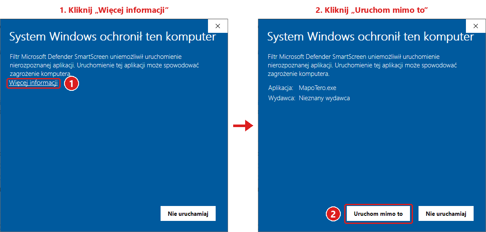
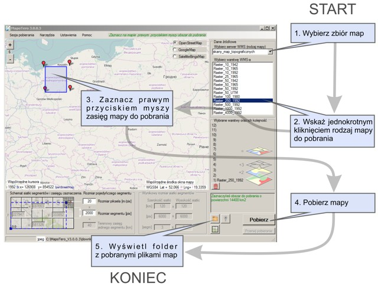
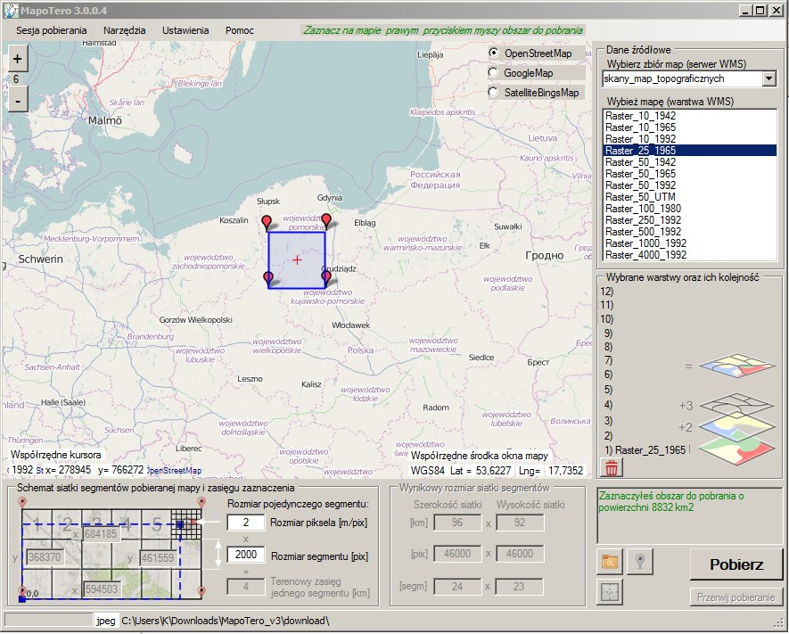
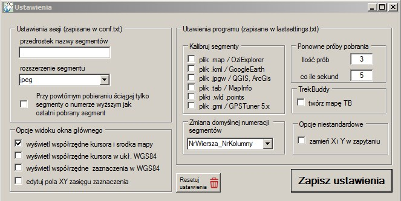

# MapoTero

**MapoTero** to darmowy program służący do pobierania rastrowych map z internetu, opublikowanych za pośrednictwem serwerów WMS (takich jak Geoportal2, PIG, GDOŚ) oraz usług kafelkowych WMTS i XYZ/TMS (np. Waymarked Trails, OSMapa.pl, UMP-pcPL). 

Program pobiera mapy, dzieląc wybrany obszar na siatkę kwadratowych segmentów (do 2048×2048 px). Pobrane segmenty map można następnie:
* **scalić w jeden duży plik rastrowy** (GeoTIFF, JPEG, PNG) przy użyciu wbudowanej funkcji *"złącz pobrane segmenty w jeden arkusz"*,
* **wyeksportować do map dla odbiorników GPS i aplikacji mobilnych:** Garmin BirdsEye (JNX - wielopoziomowy raster bez limitu 100 kafli), Garmin Custom Maps (KMZ z wyborem z-order i obsługą przezroczystych nakładek PNG), MBTiles (Locus Map, OsmAnd, OruxMaps), SQLiteDB (OsmAnd, Locus Map) i mapy offline OruxMaps - także jako przezroczyste nakładki lub z kilkoma warstwami nałożonymi na siebie,
* **wstawić do rysunku CAD** (AutoCAD, AutoCAD LT, BricsCAD, ZWCAD i inne): rysunek DXF z rastrami na właściwych współrzędnych, obrysem, siatką i numerami segmentów oraz skrypt SCR lub program LISP, które wstawiają mapę do otwartego rysunku,
* **wgrać do urządzeń GPS** i aplikacji turystycznych (np. [TrekBuddy](http://www.trekbuddy.net/forum/index.php), [OziExplorer](http://www.oziexplorer.com/)),
* **wyświetlić jako podkład georeferencyjny** w programach GIS i GPS: [QGIS](https://www.qgis.org/), [Google Earth](https://www.google.pl/intl/pl/earth/), ArcGIS, GPS Tuner, MapInfo.

* **Obsługiwane formaty rastrowe:** JPEG, TIFF, PNG, GIF; arkusze scalone: GeoTIFF, JPEG, PNG.
* **Obsługiwane formaty georeferencji:** MAP, KML, TAB, JPGW, WLD, GMI, PRJ.
* **Eksport do CAD:** rysunek DXF (R2000), skrypt SCR i program LISP (.lsp).
* **Układy współrzędnych:** PL-1992, PL-2000 (strefy 5-8), UTM (strefy 33N-35N), WGS84.
* **Podręcznik użytkownika online:** [eksploracja.github.io/MapoTero/pomoc/](https://eksploracja.github.io/MapoTero/pomoc/)
* **Oficjalny profil programu:** [facebook.com/mapotero.opensource](https://www.facebook.com/mapotero.opensource)

---

## Pobieranie i dokumentacja

Program to jeden plik **MapoTero.exe** (wersja 64-bitowa dla systemu Windows), dostarczany w paczce ZIP razem z folderem `warstwy` (zbiory map):
* 📥 **[Pobierz najnowszą wersję MapoTero z GitHub Releases (MapoTero_v3.18.zip)](https://github.com/Eksploracja/MapoTero/releases/download/v3.18/MapoTero_v3.18.zip)** – po rozpakowaniu uruchom `MapoTero.exe` (folder `warstwy` musi leżeć obok niego).
* 📖 **[Podręcznik użytkownika i pomoc online](https://eksploracja.github.io/MapoTero/pomoc/)** – 39 rozdziałów instrukcji krok po kroku z motywem Just the Docs, opis narzędzi, formatów i konfiguracji.
* 📦 Wszystkie wydania, kody źródłowe i historia wersji: **[GitHub Releases](https://github.com/Eksploracja/MapoTero/releases/latest)**.

> [!NOTE]
> **Pierwsze uruchomienie w systemie Windows (komunikat SmartScreen):**  
> Program jest w pełni bezpieczny i otwartoźródłowy (GPLv3), lecz nie posiada kosztownego komercyjnego certyfikatu podpisu cyfrowego. System Windows może przy pierwszym uruchomieniu wyświetlić niebieski monit *"System Windows ochronił ten komputer"*.  
> * **Jak uruchomić:** Kliknij odnośnik **„Więcej informacji”**, a następnie przycisk **„Uruchom mimo to”**.  
>
> 
>
> * **Wskazówka:** Możesz także przed rozpakowaniem kliknąć prawym przyciskiem myszy na pobranym pliku ZIP → **Właściwości** → zaznaczyć pole **„Odblokuj”** na dole i kliknąć **OK**.
> * **Jak sprawdzić plik:** w opisie każdego [wydania](https://github.com/Eksploracja/MapoTero/releases/latest) są sumy kontrolne SHA-256 archiwum ZIP i pliku `MapoTero.exe` oraz odnośnik do wyniku skanu programami antywirusowymi w serwisie VirusTotal.

---

## Aktualności

* **W przygotowaniu – poprawki z przeglądu programu:**
  * **Polskie litery w ścieżkach przy angielskim formacie regionalnym:** przy formacie regionalnym innym niż polski (np. „angielski (USA)”) program zapisywał `lastsettings.txt`, `conf.txt` i pliki georeferencji w niewłaściwej stronie kodowej – ścieżka z polskimi literami (np. nazwa użytkownika Windows) zmieniała się z „Łukasz” na „Lukasz”, a po ponownym uruchomieniu program wczytywał inną sesję niż ostatnio używana; teraz pliki są zapisywane w stronie kodowej systemu, jak w dawnych wersjach,
  * **Komunikaty błędów po polsku:** typowe błędy (brak uprawnień, plik otwarty w innym programie, brak folderu, brak miejsca na dysku, przekroczony czas odpowiedzi serwera, uszkodzony obraz) są opisane po polsku ze wskazówką, co zrobić, zamiast angielskiej treści z .NET,
  * **Komunikaty przy uruchamianiu:** błąd odczytu `conf.txt` nie jest już zastępowany komunikatem „Wczytano ostatnio zapisane ustawienia”; program podaje ścieżkę uszkodzonego pliku, informuje o uszkodzonym `lastsettings.txt`, o braku folderu `warstwy` oraz o tym, że folder ostatniej sesji nie istnieje i wczytano inną sesję,
  * **Klawisz Esc zamyka okna narzędzi** (scalanie, eksport, korekta obrazów, wielowarstwowy MBTiles, nakładanie map, usuwanie pustych segmentów, instrukcja, pomoc), a okna o zmiennym rozmiarze mają rozmiar minimalny – po zmniejszeniu przyciski nie znikają poza oknem,
  * **Wielowarstwowy MBTiles na laptopach 1366×768:** okno zmniejsza się do wysokości ekranu z paskiem przewijania – przyciski *Kompiluj MBTiles* i *Zamknij* były poza ekranem,
  * **Nakładanie map:** instrukcja w oknie opisuje wybór folderów przyciskami i przycisk *Składaj warstwy* (wcześniej nieistniejący „Połącz mapy”); program odrzuca ścieżki względne,
  * **Czytniki ekranu:** pola zasięgu i siatki w oknie głównym mają właściwe nazwy dostępności,
  * **Szybkie usuwanie do Kosza:** usuwanie pustych segmentów i *Usuń pobrane* dla folderu spoza `download` trwa sekundy zamiast minut (300 plików: ok. 1 s zamiast 21 s) – przy ponad 50 plikach trafiają one do Kosza jako jeden folder „MapoTero - usunięte pliki (data i godzina)”,
  * **Komunikat o złym zasięgu pobierania** mówi, co poprawić (np. „X górne (północ) musi być większe od X dolnego”), zamiast ogólnego „Niepoprawne współrzędne X, Y”,

* **16.11.2026 – Wersja 3.18:**
  * **Bieżący podgląd zestawu warstw z lupą rastrową (okno główne):** nowy panel podglądu na żywo w prawym dolnym narożniku okna głównego, renderujący w tle próbkę dobranych warstw ze środka siatki pobierania (przy obszarze wzdłuż trasy - ze środka pobieranego segmentu najbliższego środkowi siatki; bez siatki - ze środka widoku mapy, za którym podgląd podąża) z uwzględnieniem krycia i trybów mieszania; przyciski powiększenia pokazują próbkę w skali 1:1 (piksel w piksel), lupę ×2 albo większy obszar ×½ pobrany z serwera (nie zmniejszony wycinek); warstwy, których nie udało się pobrać, oznacza czerwona ramka i ich lista w podpowiedzi,
  * **Post-processing MIP dla odbiorników Garmin (podgląd na żywo):** specjalny filtr kontrastu, nasycenia, korekcji gamma i wyostrzania krawędzi (filtr splotowy Laplaciana 3×3) zaprojektowany dla ekranów transrefleksyjnych Memory-In-Pixel (MIP), na których standardowe mapy rastrowe w pełnym słońcu bywają wyblakłe i nieczytelne; nowe okno podglądu (*Podgląd MIP...*) pozwala na bieżąco dostroić parametry i sprawdzić efekt na próbce mapy przed wygenerowaniem pliku KMZ, JNX lub GeoTIFF; program zapamiętuje własne ustawienia suwaków, a wyostrzanie działa jednakowo na brzegach kafli i pasów arkusza oraz na niższych poziomach powiększenia MBTiles i JNX; gotowe profile korekty (Garmin MIP, wyostrzenie krawędzi, stare mapy, jasne lasy, podkład CAD, skan CAD) działają też przy scalaniu segmentów, nakładaniu map i w wielowarstwowym MBTiles,
  * **Korekta i optymalizacja obrazów w folderze** (menu *Narzędzia*, także przycisk w oknie *Eksport do CAD*): poprawia naraz wszystkie obrazy PNG, JPEG i TIFF z wybranego folderu według profilu korekty i zapisuje kopie w osobnym folderze (domyślnie podfolder `korekta`) razem z plikami georeferencji (`.jpgw`, `.pngw`, `.tifw`, `.prj`, `.map` …) i `conf.txt`; oryginały zostają bez zmian, a pliki, których nie da się odczytać, program pomija i wymienia po zakończeniu,
  * **Bezpośredni eksport do GeoTIFF (Avenza Maps, QField, CAD):** w oknie *Eksport mapy* dodano format GeoTIFF z kompresją bezstratną Deflate lub JPEG z georeferencją w nagłówkach TIFF oraz opcjonalnym generowaniem zewnętrznych plików `.tfw` (World File), `.prj` (ESRI WKT) i `.map` (OziExplorer), co pozwala na bezpośrednie otwarcie mapy w Avenza Maps, QField, ArcGIS Field Maps, AutoCAD, MicroStation czy QGIS bez konieczności osobnego scalania arkuszy,
  * **Inteligentna detekcja fałszywych sukcesów WMS:** funkcja wykrywania pustych białych segmentów zwracanych ze statusem HTTP 200 OK przez serwery WMS przy chwilowych awariach backendu bazodanowego (z bezpiecznym uwzględnieniem specyfiki białych map wektorowych/ewidencyjnych EGiB), automatycznie ponawiająca zapytania,
  * **Wyszukiwarka miejscowości, adresów i działek katastralnych ULDK (Ctrl+F, Ctrl+D):** nowy przycisk z ikoną lupy 🔍 pod powiększeniem mapy oraz skróty klawiaturowe `Ctrl+F` (miejscowość/adres) i `Ctrl+D` (działka) otwierają zintegrowane okno wyszukiwarki; zakładka *Miejscowość / Adres* pozwala błyskawicznie zlokalizować dowolne miasto, wieś, ulicę lub konkretny adres (geokoder OpenStreetMap Nominatim) i automatycznie wycentrować podgląd mapy z dopasowanym powiększeniem, natomiast zakładka *Działka katastralna (ULDK)* łączy się bezpośrednio z krajową usługą ULDK GUGiK po kodzie TERYT lub nazwie obrębu i numerze działki, pobiera urzędową geometrię działki (poligon WKT), centruje mapę na obiekcie, rysuje kontur działki i automatycznie ustawia siatkę pobierania z regulowanym marginesem (buforem) w metrach oraz pozwala jednym kliknięciem aktywować podkład ortofotomapy i granice z numerami działek EGiB,
  * **Dedykowany przycisk „Pomoc” w każdym oknie narzędziowym:** każde samodzielne narzędzie działające w osobnym oknie (Scalanie segmentów, Eksport mapy, Eksport do CAD, Kreator dodawania serwerów, Obszar wzdłuż trasy / korytarz, Konwerter OziExplorer .map, Nakładanie map, Usuwanie pustych segmentów, Ustawienia programu oraz Wyszukiwarka) posiada dedykowany przycisk *Pomoc*, który otwiera okno podręcznej instrukcji dedykowanej ściśle dla danego narzędzia z aktywnym odnośnikiem do odpowiedniego rozdziału podręcznika online,
  * **Nowa sesja jednym kliknięciem:** przycisk z ikoną kartki z zielonym plusem obok przycisków folderu i siatki (oraz *Sesja pobierania > Nowa sesja*) czyści wybrane warstwy, zasięg, zaznaczenie i siatkę na mapie, obszar wzdłuż trasy i kontur działki, przywraca domyślny bok segmentu i rozmiar piksela, zwija drzewo warstw z rozwiniętymi skanami map topograficznych GUGiK i pokazuje całą Polskę; pobrane pliki zostają na dysku, a następne pobieranie trafia do nowego podfolderu sesji,
  * **Poprawki:** eksport GeoTIFF umieszcza nakładkę o siatce przesuniętej względem mapy podstawowej we właściwym miejscu i zapisuje bardzo szerokie mapy pasami (bez braku pamięci), wielowarstwowy MBTiles kompiluje się wielokrotnie szybciej przy dużej liczbie kafli, *Usuń pobrane* przy sesji spoza folderu `download` przenosi do Kosza tylko jej pliki (a nie cały folder z innymi danymi), wyszukiwarka miejscowości zgłasza brak połączenia zamiast „nie znaleziono”, biały segment jest ponawiany raz od razu (bez kolejnych rund i przerw), plik `.map` OziExplorera ma poprawne współrzędne na półkuli zachodniej i południowej, okno eksportu i przyciski *Pomoc* nie są obcinane ani przesunięte po przeskalowaniu okien,
  * **Domyślne uruchamianie w oknie zmaksymalizowanym oraz responsywne okno eksportu:** program domyślnie otwiera się w pełnym oknie zmaksymalizowanym, a okno eksportu automatycznie dopasowuje swoją wysokość do dostępnego obszaru roboczego ekranu (z pionowym paskiem przewijania na mniejszych ekranach i laptopach),
  * **Profil wysokościowy i uzupełnianie rzędnych NMT / LIDAR w śladach GPX:** okno obszaru wzdłuż trasy (korytarza) zyskało funkcję pobierania rzeczywistych wysokości terenu z lotniczego skaningu laserowego (NMT GUGiK) dla wszystkich punktów śladu, generując dynamiczny wykres profilu podłużnego z podsumowaniem przewyższeń (wysokość min/max, podejścia, zejścia, dystans) oraz opcją natychmiastowego zapisu wzbogaconego pliku GPX z tagami `<ele>` dla odbiorników i zegarków GPS,
  * **Konwerter kalibrowanych map OziExplorer (.map -> Garmin JNX / KMZ / MBTiles):** samodzielne narzędzie (*Narzędzia -> Konwertuj mapę OziExplorer (.map)...* oraz Drag & Drop plików `.map` lub całych folderów na okno programu) przetwarzające pojedynczo lub hurtowo (całe katalogi i zbiory plików) skalibrowane skany do formatów mobilnych Garmin BirdsEye (JNX v4), Garmin Custom Maps (KMZ) oraz MBTiles z automatyczną korektą historycznych układów współrzędnych i Datum (Borowa Góra, Potsdam, Pulkovo 1942 / Układ 1942 do WGS84), likwidując problematyczne przesunięcie 100–200 m w odbiornikach turystycznych; arkusze o dużym zasięgu kalibrowane są modelem rzutowym lub wielomianem 2. stopnia, punkty mogą być podane także w siatce UTM, a JNX i MBTiles zawierają piramidę 5 poziomów powiększenia,
  * **Automatyczne dzielenie dużych map KMZ na tomy:** przy eksporcie map przekraczających limit 100 kafli Garmina program oferuje inteligentny podział na tomy (`_tom1.kmz`, `_tom2.kmz` itd.) bez konieczności sztucznego obniżania rozdzielczości ani okrawania obszaru wędrówki,
  * **Odporność na aliasy klastrów WMTS:** automatyczna obsługa rozbieżności nazw warstw za load balancerem Geoportalu (`ISOK_Cien` <-> `Cieniowanie` w usłudze ShadedRelief),
  * **Usprawnienia interfejsu użytkownika:** optymalizacja układu panelu warstw w oknie głównym eliminująca przycinanie wartości 100% w polu wprowadzania krycia warstwy oraz pełna obsługa przeciągania całych folderów z mapami,
  * **Rozbudowany pakiet testów jednostkowych i integracyjnych:** 886 testów automatycznych (.NET 10 x64) weryfikujące wszystkie operacje matematyczne, układy współrzędnych, algorytmy rastrowe, konwersje wsadowe i symulacje interfejsu użytkownika,

* **12.11.2026 – Wersja 3.17:**
  * **Pakiet map przygranicznych (Czechy, Słowacja, Niemcy, Litwa, Bałtyk):** nowa grupa w drzewie warstw *Kraje sąsiednie i strefa przygraniczna*, zawierająca zrozumiałe dla polskich użytkowników urzędowe skany map topograficznych w pełnej gamie skal (od 1:10 000 przez 1:25 000 do 1:50 000), ortofotomapy lotnicze oraz rzeźbę terenu i cieniowanie (NMT/LIDAR/batymetria): Czechy (ČÚZK – skany map topograficznych ZTM 1:10k, 1:25k, 1:50k, wieloskalowa mapa WMTS i Ortofoto), Słowacja (ZBGIS – skany map topograficznych ZM10, ZM25, ZM50, ZM100, Ortofoto, DMR 5.0 oraz Freemap Slovakia Karpaty XYZ), Niemcy (BKG – basemap.de WMTS; Brandenburgia – skany DTK10, DTK25, DTK50, SDOP 20 cm i DGMSHADE 1 m; Saksonia – skany DTK25, DTK50, DOP 20 cm i Relief DGM), Litwa (INSPIRE – ewidencja gruntów/działki, warstwice i drogi), Morze Bałtyckie (EMODnet Bathymetry – batymetria, rzeźba dna i izobaty) oraz OpenTopoMap (ogólnoeuropejska mapa topograficzna z poziomicami i cieniowaniem dla Litwy, Ukrainy i Białorusi), co pozwala na przygotowanie spójnych map turystycznych w strefach granicznych bez białych plam,
  * **Bezpośredni eksport do Garmin BirdsEye (JNX):** format Garmin BirdsEye (wersja 4) z pełną piramidą powiększeń bez restrykcyjnego limitu 100 kafli znanego z Custom Maps (do 50 000 kafli na plik), z automatycznym wyliczaniem poziomów skali i kolejności rysowania (z-order); gotowy plik `.jnx` wystarczy skopiować do folderu `Garmin/BirdsEye` w urządzeniu z odblokowanym oprogramowaniem (patshowanym firmware),
  * **Ulepszenia Garmin Custom Maps (KMZ):** obsługa kolejności rysowania (`drawOrder`: standardowa 50, pod siatką dróg wektora 25, na wierzchu 75), pełna obsługa przezroczystych nakładek PNG w formacie KMZ oraz inteligentny licznik kafli korytarza trasy (do limitu 100 kafli zliczane są wyłącznie kafle zawierające dane, zapobiegając niepotrzebnemu obniżaniu rozdzielczości),
  * **Przeciągnij i upuść (Drag & Drop) tras GPX, KML i KMZ:** plik ze śladem wycieczki wystarczy przeciągnąć z Eksploratora Windows na okno programu lub mapę – okno definiowania korytarza otwiera się od razu z wczytaną trasą i parametrami, a mapa dopasowuje widok do przebiegu śladu,
  * **Usprawnienia okna Eksport mapy:** konkretne podpowiedzi ścieżek docelowych dla urządzeń GPS i aplikacji mobilnych (`Garmin/BirdsEye`, `Garmin/CustomMaps`, `Locus/maps`, `osmand/tiles`, `oruxmaps/mapfiles`) oraz przycisk *Pokaż w folderze*, otwierający Eksplorator Windows ze wskazanym plikiem po zakończonym eksporcie,
  * **Kreator dodawania serwerów – katalog gotowych usług publicznych na start i czytelne nazwy:** okno kreatora otwiera się od razu na katalogu z wbudowaną listą ponad 100 sprawdzonych usług dodatkowych bez skorowidzów (m.in. GUGiK – archiwalne ortofotomapy, BDOT10k/BDOO/TOPO WMS, NMT cieniowanie/hipsometria WMS, K-GESUT, osnowy podstawowe i specjalne, usługi INSPIRE, KIMP/KIBDOT; PGW Wody Polskie – zagrożenie powodziowe i hydrografia; PIG-PIB – osuwiska SOPO, jaskinie, złoża MIDAS, geologia 1:200k/1:500k 2022, geostanowiska, podtopienia, wody mineralne; GIOŚ; Ekoportal – pożary lasów i mapy hałasu; IMGW; GUS; oraz kafelki XYZ z katalogu NextGIS QuickMapServices: ESRI Imagery/Topo/Street/Hillshade, EOX Sentinel-2 2024, OpenTopoMap, CartoDB, OpenStreetMap DE/HOT/FR, CyclOSM, Freemap.sk, OpenRailwayMap, OpenSeaMap) oraz z bezpośrednim dostępem online do oficjalnego wykazu Geoportal.gov.pl i rejestru EZiUDP (usługi centralne, wojewódzkie oraz wyszukiwarka usług powiatowych i gminnych po nazwie lub kodzie TERYT); przycisk *+ Wpisz własny adres URL…* pod listą (albo wklejenie adresu `http(s)://` w polu wyszukiwania) przełącza do ręcznego wpisania własnego serwera WMS/WMTS/XYZ, a po wybraniu usługi kreator pobiera warstwy z podglądem i możliwością powrotu przyciskiem *← Wróć do listy usług*; warstwy zapisane kreatorem zachowują w grupie *Dodane serwery* i na liście wybranych warstw swoje czytelne nazwy z serwera,
  * **Obsługa kafelków XYZ / TMS:** bezpośrednie pobieranie map z prostych serwerów kafli `{z}/{x}/{y}` i TMS (`{-y}`) w tym wbudowanych zbiorów *OSMapa.pl*, *UMP-pcPL* i przezroczystych nakładek szlaków *Waymarked Trails* (piesze, rowerowe, MTB, konne, rolkowe, narciarskie); kreator serwerów rozpoznaje szablony `{z}/{x}/{y}`, TileJSON oraz `tilemapresource.xml`, podkład dodany po nakładce automatycznie trafia pod spód, a pobieranie samych nakładek obsługuje przezroczyste tło PNG,
  * **Kafle XYZ / TMS – poprawki:** ostrzeżenie przed pobieraniem, gdy obszar leży w całości poza zasięgiem mapy (np. OSMapa.pl poza Polską) i segmenty byłyby puste; brakujące na serwerze kafle podkładu (HTTP 404, zwykle na największym powiększeniu) program zastępuje powiększonym fragmentem kafla z poziomu wyżej zamiast zostawiać białe pola; odmowa dostępu (HTTP 403) kończy pobieranie od razu, z podpowiedzią o polu `referer`; szablony mogą zawierać `{quadkey}` (serwery w stylu Bing) i `{r}` (przyrostek kafli retina z Leaflet, pomijany),
  * **Drzewo map w grupach tematycznych:** dawną listę zbiorów map i listę warstw zastąpił jeden panel *Wybierz mapy* - drzewo z grupami *Ortofotomapy*, *Mapy topograficzne*, *Rzeźba terenu*, *Mapy historyczne i zabytki*, *Ewidencja, geodezja i uzbrojenie*, *Granice i adresy*, *Przyroda i środowisko*, *Geologia* i podgrupami (np. *Działki ewidencyjne (KIEG)*, *Formy ochrony przyrody (GDOŚ)*); warstwy mają zrozumiałe nazwy (np. *Nadleśnictwa* zamiast `5`, *Mapa szczegółowa WIG 1:25 000 (1918–1939)* zamiast `wig25k_2180`) i pola wyboru - zaznaczenie dodaje warstwę na wierzch kanapki, odznaczenie ją usuwa, a przy grupie widać liczbę wybranych warstw; można dobierać warstwy z różnych serwerów; przycisk ⊞/⊟ rozwija lub zwija wszystkie grupy, a pole *szukaj warstwy…* filtruje warstwy (po nazwach i nazwach technicznych, bez względu na wielkość liter i polskie znaki); grupy i nazwy opisuje plik `warstwy/katalog.txt`, a serwery dodane kreatorem trafiają do grupy *Dodane serwery*; panel wybranych warstw jest niższy i przewijany, więc drzewo ma więcej miejsca,
  * **Porządki w zbiorach map:** usunięte zdublowane zbiory `Hgis_*` (te same warstwy są w *Mapach historycznych (IHPAN)*), warstwy-skorowidze (siatki arkuszy TrueOrtho, zasięgi powiatów KIEG) i nieistniejąca już warstwa skanów 1:100 000; dodane mapy historyczne IHPAN (Übersichtskarte von Mitteleuropa 1:300 000, mapa Galicji Kummersberga 1:115 200, Śląsk w XVIII w., plany Wrocławia 1944, Warszawy 1822 i Pragi 1796) oraz sieci specjalne i niezidentyfikowane KIUT; zaktualizowane adresy i nazwy warstw PRG (nowa usługa `AdministrativeBoundaries` i `INSPIRE/Addresses` oraz *Państwowy Rejestr Nazw Geograficznych* PRNG), prefiksy warstw GDOŚ, działające warianty IHPAN (`wroclaw_3857`, `wig300k_3857`), zalecane piksele dla obrębów EGiB i mapy geologicznej 1:500 000 oraz warstwa *Regionalne dyrekcje Lasów Państwowych* (BDL); dodane nowe szybkie zbiory kafelkowe WMTS (*Mapa topograficzna GUGiK*, *Mapa ogólnogeograficzna BDOO z cieniowaniem*, *Hipsometria z cieniowaniem NMT 1 m*) i warstwa *Szczyty górskie i wzniesienia*; usunięte nieaktualne komunikaty o limicie 256 px nieczynnego serwera hgis.cartomatic.pl,
  * **Nowe mapy i poprawki po sprawdzeniu wszystkich warstw:** nowe zbiory *Mapa glebowo-rolnicza 1:5000* (kontury i odkrywki glebowe, GUGiK) i *Regiony fizycznogeograficzne* (makro- i mezoregiony, PIG-PIB); w gałęzi *Mapy historyczne i zabytki* nowa podgrupa *Zabytki i dziedzictwo (NID)* obejmująca rejestr zabytków nieruchomych (zasięgi i typy oraz INSPIRE), rejestr zabytków archeologicznych, krajową ewidencję zabytków nieruchomych i archeologicznych, Pomniki Historii, obiekty światowego dziedzictwa UNESCO oraz groby i cmentarze wojenne; w *Mapach historycznych (IHPAN)* 15 kolejnych map, m.in. mapy Schroettera, Gilly'ego, Textora-Sotzmanna i Gaula, Topograficzna Karta Królestwa Polskiego 1:126 000, mapa Reymanna 1:200 000, Dwuwiorstówka 1:84 000, WIG 1:100 000 w układzie „Borowa Góra”, plan Warszawy Lindleyów i mapy ziem Korony w XVI w.; cieniowanie i hipsometria NMT 1 m pobierane jako kafle WMTS zamiast wolnych usług WMS; *Mapa topograficzna OpenStreetMap* korzysta z warstwy `TOPO-OSM-WMS` (dawna `TOPO-WMS` pokazywała tylko tło), a nazwy map terrestris informują o znaku wodnym, który ta darmowa usługa dokleja do obrazów; usunięta pusta warstwa *Działki – uzupełnienie z LPIS*,
  * **Nowy panel *Wybrane warstwy oraz ich kolejność*:** usuwanie pojedynczej warstwy (przycisk kosza, ✕ albo klawisz Delete) zamiast czyszczenia całej listy, zmiana kolejności warstw przyciskami ▲ ▼, przeciąganiem myszą lub Ctrl+strzałka, menu warstwy pod prawym przyciskiem myszy; ta sama warstwa nie trafia na listę dwa razy, a rysunek kanapki w tle listy zasłaniają kolejne wybierane warstwy,
  * **Krycie warstw:** pole *Krycie %* w panelu (i menu warstwy) nadaje zaznaczonej warstwie krycie od 5 do 100% - przez częściowo przezroczystą warstwę prześwituje to, co leży pod nią (np. granice działek na ortofotomapie); warstwy o kryciu mniejszym niż 100% pobierane są z serwera WMS osobnymi zapytaniami i nakładane w programie, a sąsiednie warstwy w pełni kryjące nadal jednym zapytaniem; krycie zapisywane jest w `conf.txt`,
  * **Kanapka z warstw różnych serwerów WMS i WMTS:** każda wybrana warstwa pamięta swój zbiór map, więc wybór warstwy z innego zbioru nie czyści już wybranych warstw - np. na mapę topograficzną można nałożyć cieniowanie rzeźby ISOK z kryciem 50%, a na ortofotomapę WMTS granice działek; przy warstwach z różnych zbiorów lista pokazuje nazwę zbioru, a segment składany jest w programie z osobno pobranych grup warstw,
  * **Rozmiar piksela wg najdokładniejszej warstwy:** program wpisuje najmniejszy zalecany rozmiar piksela spośród wybranych warstw (dawniej - rozmiar ostatnio klikniętej warstwy, więc np. dodanie granic administracyjnych po mapie topograficznej zmieniało piksel z 2 na 16 m); po usunięciu warstwy rozmiar jest przeliczany, a rozmiaru wpisanego ręcznie program nie zmienia - podaje tylko wartość zalecaną,
  * **Okno *Warstwy - zaawansowane* (przycisk … w panelu):** suwaki krycia wszystkich warstw, kolejność, liczba zapytań na segment i podgląd kanapki - ta sama próbka co w panelu okna głównego (warstwy już pobrane przez panel nie są pobierane ponownie), z lupą 1:1, ×2 i ×4, odświeżana od razu po zmianie krycia lub kolejności,
  * **Regulowana szerokość prawego panelu:** pasek między mapą a panelem *Dane źródłowe* można przeciągnąć myszą w lewo - drzewo map, lista wybranych warstw i pole komunikatów poszerzają się, więc widać długie nazwy warstw; panel można poszerzyć, gdy okno jest szersze od najmniejszego (np. zmaksymalizowane), a w węższym oknie panel zwęża się sam, żeby zmieściła się mapa i schemat siatki; szerokość zapisywana jest w `lastsettings.txt`,
  * **Bezpieczeństwo danych i ułatwienia sesji:** przycisk *Usuń pobrane* przenosi pliki do systemowego Kosza (zamiast bezpowrotnego usuwania) i dotyczy wyłącznie bieżącej sesji; ikona folderu otwiera bezpośrednio właściwy folder bieżącej sesji; program ostrzega przed utratą przezroczystości w formacie JPEG przy warstwach z kryciem < 100% i proponuje przełączenie na PNG; w eksporcie CAD wprowadzono barierę ochronną przy próbie wstawienia > 1000 pojedynczych rastrów, a błędy serwerów WMS dotyczące nieobsługiwanego układu współrzędnych (CRS) są czytelnie sygnalizowane,
  * **Pełna pomoc programu w GitHub Pages:** 39 rozdziałów przewodnika użytkownika z motywem Just the Docs, instrukcje, tabele parametrów i zrzuty ekranu pod adresem [eksploracja.github.io/MapoTero/pomoc/](https://eksploracja.github.io/MapoTero/pomoc/).

<b>Historia wcześniejszych wydań (od wersji 3.16 do 3.0.0.9)</b> — kliknij, aby rozwinąć

* **09.11.2026 – Wersja 3.16:**
  * **Eksport do CAD (menu *Narzędzia > Eksport do CAD*):** rysunek DXF (R2000) z odnośnikami do rastrów na właściwych współrzędnych - segmenty sesji albo scalony arkusz (world file lub GeoTIFF) - z obrysem, siatką i numerami segmentów, trasą korytarza i opisem mapy na warstwach `MAPOTERO_...`; skrypt SCR (AutoCAD, AutoCAD LT, BricsCAD, ZWCAD) i program LISP (`APPLOAD`), które wstawiają mapę do otwartego rysunku pod istniejące obiekty i przywracają ustawienia rysunku; w oknie eksportu przycisk *scal teraz...* do złączenia segmentów w jeden arkusz,
  * **Ochrona serwerów map przed przeciążeniem:** łączna liczba jednoczesnych zapytań do jednego serwera nie przekracza liczby wątków z ustawień (także przy WMTS); po odpowiedzi serwera o przeciążeniu (HTTP 429, 502, 503, 504) lub serii przekroczeń czasu program robi przerwę i zmniejsza liczbę zapytań o połowę, a potem stopniowo ją przywraca - mniejsze ryzyko zablokowania adresu IP przez serwer,
  * **.NET 10:** program działa w środowisku .NET Desktop Runtime 10 (x64) - wsparcie .NET 8 kończy się 10.11.2026,
  * **Obsługa awarii:** opis nieoczekiwanego błędu zapisywany jest w pliku `awarie.log`, a okno komunikatu podaje adres zgłoszeń i pozwala kontynuować pracę,
  * **Poprawki:** położenie arkuszy GeoTIFF zapisanych jako *PixelIsPoint* (przesunięcie o pół piksela).
* **23.10.2026 – Wersja 3.15:**
  * **Kreator dodawania serwerów WMS i WMTS (menu *Narzędzia* lub przycisk `[+]` przy liście map):** automatyczna analiza dokumentu `GetCapabilities` (WMS 1.3.0, WMS 1.1.1 oraz WMTS 1.0.0), prezentacja drzewa warstw z wyszukiwarką/filtrem, matematyczne wyliczanie zalecanego rozmiaru piksela ze skali minimalnej, weryfikacja obsługiwanych układów CRS, podgląd próbnego kafelka 256×256 px i bezpośredni zapis nowego zbioru map do katalogu `warstwy/` (także w folderze użytkownika przy braku uprawnień w Program Files); ponawianie chwilowych błędów HTTP i poprawne polskie znaki w dokumentach ISO-8859-2,
  * **Siatka segmentów na mapie i zmiana zasięgu uchwytami:** po zaznaczeniu obszaru prawym przyciskiem myszy na mapie widać siatkę segmentów; uchwyty w narożnikach i na bokach przesuwają krawędzie o pełne segmenty, a uchwyt w środku przesuwa całą siatkę (Esc przywraca poprzedni zasięg); siatkę można wyłączyć w ustawieniach,
  * **Wielowarstwowy i wieloskalowy MBTiles (menu *Narzędzia*):** kompilacja kilku pobranych sesji do jednego pliku MBTiles - każda warstwa widoczna w wybranym zakresie powiększeń (np. z daleka topo 1:100k, w zbliżeniu topo 1:10k, a najbliżej ortofotomapa) albo nałożona na inne z kryciem, trybem mieszania i odcieniami szarości; podgląd wybranego poziomu powiększenia i wbudowana pomoc,
  * **Zbiory map:** zbiór *ortofotomapa* korzysta z usługi Geoportalu HighResolution, a adresy zbiorów map z protokołem https,
  * **Bezpieczniejsze pobieranie:** w trakcie pobierania nie można zmienić warstw, wczytać innej sesji ani scalać map; błąd jednego segmentu nie przerywa całego pobierania; obsługa obszarów do 10 mln segmentów i szybkie wyznaczanie korytarza trasy przy małym segmencie; pobieranie innego obszaru do folderu z segmentami innej sesji proponuje nowy podfolder, a przedrostek nazw segmentów nie może zawierać znaków niedozwolonych w nazwach plików,
  * **Poprawki:** opcja *pobieraj tylko segmenty o numerze wyższym niż ostatni pobrany* działa zgodnie z opisem, scalanie zachowuje przezroczystość PNG i GeoTIFF i nie zajmuje nadmiernie pamięci, poprawny plik `.wld` dla WGS84, usuwanie pustych segmentów do Kosza z potwierdzeniem, zapamiętywanie opcji widoku i ustawień nowej sesji, domyślny limit czasu odpowiedzi 120 s,
  * **Jeden plik programu:** program to pojedynczy plik `MapoTero.exe` z folderem `warstwy` obok niego.
* **20.10.2026 – Wersja 3.14:**
  * **Obszar pobierania wzdłuż trasy** (menu *Sesja pobierania*): po wskazaniu pliku GPX, KML lub KMZ (np. trasy zaplanowanej w Mapy.com, Komoot czy Locus Map) i szerokości pasa pobierane są tylko segmenty leżące wzdłuż trasy, a nie cały prostokąt - przy trasie ukośnej lub krętej wielokrotnie mniej danych; trasa i wybrane segmenty widoczne są na mapie, a korytarz zapisywany jest w folderze sesji (`korytarz.txt`),
  * **Przezroczyste nakładki:** opcja *przezroczyste tło* w ustawieniach (parametr `TRANSPARENT=TRUE` zapytań WMS dla segmentów PNG / GIF), w eksporcie opcja *nakładka* (kafle PNG, w MBTiles typ `overlay`) oraz zamiana białego tła na przezroczyste dla serwerów, które przezroczystości nie obsługują,
  * **Łączenie warstw podczas eksportu:** na mapę można nałożyć warstwy z innych folderów sesji (np. granice działek lub cieniowanie rzeźby na ortofotomapie) z regulacją krycia - także pobrane w innym układzie współrzędnych,
  * **Nowe formaty eksportu:** SQLiteDB (format RMaps dla OsmAnd i Locus Map) oraz mapy offline OruxMaps (folder z bazą `OruxMapsImages.db` i kalibracją `.otrk2.xml`); bazy po eksporcie można otwierać tylko do odczytu,
  * **Rozmiar pliku:** szacowanie rozmiaru mapy przed eksportem (na podstawie próbnych kafli) i dobór najwyższego poziomu powiększenia do limitu w MB,
  * **Opis mapy:** data pobrania i źródło danych zapisywane w `conf.txt` oraz w eksportowanych mapach (nazwa mapy z datą pobrania, opis i atrybucja w MBTiles, opis w KMZ), a polecenie *odśwież mapę* pobiera ponownie wszystkie segmenty sesji (stary plik segmentu jest zastępowany dopiero po udanym pobraniu nowego).
* **08.10.2026 – Wersja 3.13:**
  * **Wydajność scalania segmentów:** jednokrotne buforowanie wiersza segmentów w pamięci RAM zamiast wielokrotnego dekodowania kafli z dysku (wielokrotne przyspieszenie tworzenia dużych arkuszy),
  * **Eksport MBTiles:** naprawa transakcji SQLite i zapytań (rozwiązanie błędu `InvalidOperationException`), optymalizacja parametrów SQL, włączenie trybów `PRAGMA synchronous = OFF` oraz `WAL`, buforowanie kodeka JPEG,
  * **Odporność pobierania:** naprawa wznawiania sesji – brakujące segmenty są identyfikowane na podstawie fizycznego istnienia plików na dysku; atomowe przenoszenie plików tymczasowych; izolacja anulowania zadań WMTS,
  * **Zarządzanie pamięcią i zasobami natywnymi:** gwarantowane zwalnianie uchwytów plików KMZ (`FileStream`) w blokach `Finally`, bezpieczne zamykanie LibTiff w GeoTIFF, obsługa paletowych obrazów PNG w `MakeTransparent`, zwalnianie zasobów GDI+ dla znaczników `GMarkerGoogle`,
  * **Stabilność UI (WinForms):** ochrona przed `ObjectDisposedException` przy zamknięciu formularzy w trakcie pracy w tle; precyzyjne porównywanie rozmiaru plików w bajtach w oknie usuwania pustych segmentów i buforowanie listy plików w RAM; bezpieczne otwieranie forum pomocy przez HTTPS w przeglądarce,
  * **Nowe okno ustawień:** zmiany stosowane po kliknięciu OK (Anuluj - bez zmian), okno zawsze pokazuje aktualne ustawienia, pola liczbowe z zakresem wartości, listy tylko do wyboru, poprawione opisy i podpowiedzi, przywracanie domyślnych z potwierdzeniem i przeliczeniem do PL-1992, tryb TrekBuddy bez kasowania plików kalibracji, usunięcie formatu svg+xml,
  * **Baza warstw i testy:** dodanie nowych warstw WMTS (m.in. BDOT10k, ortofotomapa wysokiej rozdzielczości, TrueOrtho), uporządkowanie nieaktywnych źródeł w `_archiwalne/` oraz nowy zestaw testów scalania (482 testy jednostkowe).
* **07.10.2026 – Wersja 3.12:**
  * Przejście na platformę .NET 8 (program 64-bitowy) i aktualizacja bibliotek zależnych (GMap.NET, SQLite); automatyczna kompilacja i testy w GitHub Actions,
  * Pobieranie z usług WMTS: wystarczy podać w pliku zbioru map adres usługi WMTS (przykład: zbiór *ortofotomapa_WMTS*); program sam wybiera poziom kafli odpowiadający rozmiarowi piksela, a segmenty składa z kafli i w razie potrzeby przelicza do wybranego układu - mają te same pliki georeferencji co segmenty WMS,
  * Wybór układu współrzędnych segmentów: PL-1992, PL-2000 (strefy 5-8), UTM 33N-35N, WGS84 - współrzędne obszaru i rozmiar piksela przeliczane są przy zmianie układu, a pliki georeferencji zapisywane w wybranym układzie,
  * Wbudowane scalanie segmentów do GeoTIFF (także BigTIFF, kompresja Deflate lub JPEG), JPEG i PNG - zamiast zewnętrznego programu NoToCONS; arkusz zapisywany jest strumieniowo, więc jego wielkość nie jest ograniczona pamięcią RAM,
  * Eksport mapy (menu Narzędzia > Eksport mapy, Ctrl+E) do KMZ dla odbiorników Garmin (kafle do 1024 px, limit liczby kafli), KMZ dla Locus Map / OruxMaps i MBTiles z piramidą poziomów powiększenia,
  * Kilka segmentów pobieranych jednocześnie (liczba wątków w ustawieniach), przerywanie pobierania w dowolnej chwili, okno programu nie zamraża się podczas pobierania i scalania,
  * Parametr SERVICE=WMS dodawany do zapytań (wymagany przez serwery MapServer i GeoServer), kolejność osi w zapytaniach WMS 1.3.0 zgodna z definicją układu, a opcja zamiany X i Y dotyczy tylko zapytania - nie zamienia współrzędnych zapisywanych w plikach georeferencji,
  * Domyślny podkład mapy OpenStreetMap, ostre wyświetlanie okien na ekranach o dużej rozdzielczości (skalowanie DPI),
  * Przeliczenia współrzędnych w jednej, dokładnej implementacji (szereg Krügera, zgodność z biblioteką PROJ do 1 mm) i testy jednostkowe biblioteki MapoTero.Core,
  * Uporządkowanie struktury projektu i usunięcie przestarzałego kodu v2,
  * Poprawki konfiguracji kompilacji i wsparcia dla nowoczesnych środowisk Visual Studio,
  * Naprawa ponawiania pobierania nieudanych segmentów (ustawienia "ilość prób" i "przerwa między próbami" nie były uwzględniane); okno programu nie zamraża się podczas oczekiwania na kolejną próbę,
  * Odporniejsze pobieranie segmentów: limit czasu połączenia, zapis obrazu bez ponownej kompresji JPEG, przyczyna błędu (np. komunikat serwera WMS) zapisywana w pliku error.txt,
  * Naprawa wznawiania pobierania przy numeracji segmentów NrWiersza_NrKolumny,
  * Naprawa wczytywania sesji z pliku conf.txt za jednym razem oraz zawieszania się programu przy starcie, gdy zapisany zbiór map nie istnieje,
  * Scalanie segmentów zgłasza sukces dopiero po faktycznym utworzeniu arkusza; pliki georeferencyjne scalonego arkusza zapisywane są obok niego, z poprawną nazwą i rozszerzeniem pliku,
  * Naprawa awarii przy tworzeniu plików .points dla formatu PNG oraz błędnych współrzędnych pikselowych w pliku .tab scalonego arkusza,
  * Nakładanie map: zwalnianie pamięci po każdym segmencie i obsługa plików PNG z paletą barw (png8),
  * Usuwanie pustych segmentów: brak limitu 10 000 plików, usuwanie także plików .kml, .pngw i .png.points,
  * Gdy w katalogu programu nie można zapisywać (np. Program Files), ustawienia i pobrane mapy trafiają do %LocalAppData%\MapoTero,
  * Dokładna kalibracja plików KML: zapis dokładnych narożników obrazu (gx:LatLonQuad) oraz LatLonBox z obrotem uwzględniającym zbieżność południków - dawniej kafle na wschodzie i zachodzie Polski były w KML obrócone i przeskalowane (przesunięcie narożników kafla 1 km o ok. 40 m),
  * Pliki world file (.jpgw, .pngw, ...) podają środek lewego górnego piksela zgodnie ze standardem (dawniej przesunięcie o pół piksela),
  * Dokładny zasięg segmentów o niecałkowitym wymiarze terenowym (np. 0,1 m x 2048 px) i zapis liczb z kropką dziesiętną niezależnie od ustawień regionalnych systemu,
  * Usunięcie nieużywanych bibliotek (GMap.NET.WindowsPresentation, System.Text.Encoding.CodePages) i wersji testowych (preview) bibliotek.
* **19.10.2021 – Wersja 3.11:**
  * Naprawa niedziałającej warstwy Ortofotomapa,
  * Aktualizacja adresów warstw WMS.
* **20.10.2020 – Wersja 3.10:**
  * Usunięcie usterki związanej z niewyświetlaniem podkładowej warstwy OpenStreetMap w systemie Windows 10,
  * Aktualizacja warstw WMS,
  * Zmiana platformy programistycznej .NET Framework z wersji 4.5 na 4.7.2.
* **09.09.2019 – Wersja 3.0.0.9:**
  * Aktualizacja warstw WMS,
  * Zmiana platformy programistycznej .NET Framework z wersji 3.5 na 4.5,
  * Naprawa błędu wyświetlania podkładowej warstwy OpenStreetMap.

---

## Skrócona instrukcja obsługi

1. **Wybór mapy:** W drzewie *Wybierz mapy* po prawej stronie okna programu rozwiń (kliknięciem nazwy) grupę tematyczną i podgrupę z interesującą Cię mapą - np. *Mapy topograficzne > Skany map topograficznych GUGiK* (rozwinięte przy nowej sesji). Przycisk ⊞/⊟ rozwija lub zwija wszystkie zbiory, a pole *szukaj warstwy…* pokazuje tylko warstwy pasujące do wpisanych słów.
2. **Wybór warstwy:** Zaznacz pole wyboru interesującej Cię warstwy albo kliknij jej nazwę (np. *"1:25 000, układ 1965"* lub *"1:10 000, układ 1965"*); odznaczenie usuwa warstwę. Nazwa zaznaczonej warstwy wyświetli się w polu *"Wybrane warstwy oraz ich kolejność"* - pierwsza wybrana warstwa jest podkładem, kolejne kładą się na niej. Zaznaczoną tam warstwę (lub jedyną wybraną) usuniesz przyciskiem kosza albo ✕ (lub klawiszem Delete), przesuniesz przyciskami ▲ ▼ albo przeciągając ją myszą, a w polu *Krycie %* nadasz jej przezroczystość (np. 50% - widać przez nią warstwę leżącą niżej). Przycisk … otwiera okno z suwakami krycia i podglądem kanapki. Warstwy możesz brać z różnych zbiorów map (także WMS i WMTS razem): rozwiń inną grupę w drzewie i zaznacz jej warstwę - wybrane wcześniej warstwy zostają.
3. **Zaznaczenie obszaru:** Na podglądzie mapy zaznacz prawym przyciskiem myszy zasięg pobieranego obszaru albo wskaż plik trasy (*Sesja pobierania > obszar pobierania wzdłuż trasy*).
4. **Pobieranie:** Kliknij przycisk **"Pobierz"**. Rozpocznie się pobieranie segmentów do dedykowanego podfolderu sesji w katalogu `download` (np. `download/sesja_ortofotomapa_...`), dzięki czemu pliki nie zaśmiecają folderu nadrzędnego. Ponowne kliknięcie wznawia pobieranie w tym samym folderze i dociąga brakujące kafle.
5. **Przeglądanie i scalanie:**
   * Kliknij żółty folder, aby otworzyć katalog z pobranymi plikami bieżącej sesji.
   * Opcjonalnie scal pobrane segmenty w jeden arkusz ikoną szachownicy (*"scal pobrane segmenty..."*), wybierając format arkusza (GeoTIFF, JPEG lub PNG). Arkusz zapisywany jest strumieniowo, więc może mieć dowolną wielkość (JPEG - do 65 500 px na bok).
   * Opcjonalnie wyeksportuj mapę do KMZ, MBTiles, SQLiteDB lub OruxMaps (*Narzędzia > Eksport mapy*), aby wgrać ją do odbiornika GPS lub aplikacji mobilnej.
   * Opcjonalnie wyeksportuj mapę do programu CAD (*Narzędzia > Eksport do CAD*): rysunek DXF otwórz w programie CAD, a skrypt SCR uruchom poleceniem `SCRIPT` w otwartym rysunku (jednostki: metry). Program LISP (AutoCAD, BricsCAD, ZWCAD, AutoCAD LT od wersji 2024) wczytaj poleceniem `APPLOAD` - wstawia też numery segmentów i opis, a po zakończeniu przywraca ustawienia rysunku. Oś X rysunku to wschód, oś Y - północ; mapa trafia na warstwy `MAPOTERO_...`. Przy setkach segmentów wygodniej wstawić scalony arkusz (GeoTIFF albo JPEG z plikiem world file) - przycisk *scal teraz...* w oknie eksportu.

---

## Wygląd okien programu

### Główne okno programu

### Okno ustawień

---

## Obsługiwane serwery WMS i WMTS

* **Geoportal2** (Główny Urząd Geodezji i Kartografii)
* **Państwowy Instytut Geologiczny (PIG)**
* **Generalna Dyrekcja Ochrony Środowiska (GDOŚ)**
* **Narodowy Instytut Dziedzictwa (NID)** i **Instytut Historii PAN (IHPAN)**
* **Służby geodezyjne krajów sąsiednich:** Czechy (**ČÚZK**), Słowacja (**ZBGIS**, **Freemap**), Niemcy (**BKG**, **GeoBasis-BB Brandenburgia**, **GeoSN Saksonia**), Litwa (**INSPIRE**) oraz europejskie bazy morskie (**EMODnet Bathymetry**) i **OpenTopoMap**.

Zbiory map to pliki tekstowe w katalogu `warstwy`: w pierwszym wierszu adres serwera, dalej pary wierszy - nazwa warstwy i zalecany rozmiar piksela. Grupy drzewa *Wybierz mapy* i zrozumiałe nazwy warstw opisuje plik `warstwy/katalog.txt` (UTF-8): wiersz `> Grupa` otwiera grupę, `>> Podgrupa` - podgrupę, a wiersz `zbiór | warstwa | nazwa` dodaje do niej warstwę ze zbioru map; warstwy spoza katalogu program pokazuje w grupie *Dodane serwery*. Adres usługi WMTS (np. zawierający `SERVICE=WMTS` lub `/WMTS`) oznacza pobieranie kafli WMTS; nazwą warstwy jest wtedy identyfikator warstwy z dokumentu GetCapabilities usługi.

### Wskazówki dla map w strefie przygranicznej

* **Dobór układu współrzędnych:**
  * **Warstwy WMTS i XYZ** (np. czeska *ZTM_WM*, słowacka *Freemap Outdoor*, niemiecka *basemap.de*, *OpenTopoMap*): działają bez problemu w każdym układzie (PL-1992, PL-2000, UTM, WGS84) – program przelicza je w locie na siatkę wybranego układu.
  * **Warstwy czystego WMS** (szczegółowe skany czeskie *ZTM 10/25/50*, słowackie *ZM10/25/50*, brandenburskie *DTK10/25/50*): serwery te nie obsługują polskiego układu PL-1992. W oknie głównym MapoTero wybierz dla nich układ **WGS84 (EPSG:4326)** lub strefę **UTM 33N/34N** (wspólne dla Polski i sąsiadów; Saksonia dodatkowo wspiera bezpośrednio PL-1992).
* **Nakładanie map i przezroczystość (łączenie bez białych plam):**
  * Jeśli tworzysz kompozycję z polskiego podkładu i warstwy zagranicznej, a serwer zagraniczny wypełnia obszar poza swoją granicą białym kolorem zamiast przezroczystości (np. Saksonia lub Brandenburgia), w oknie *Warstwy zaawansowane* (przycisk `…`) zmień tryb mieszania górnej warstwy na **Mnożenie (Multiply)**. W tym trybie biel staje się niewidoczna, a treść obu map (drogi, warstwice, napisy) łączy się idealnie na granicy.

---

## Kompilacja

* Wymagany Visual Studio 2026 (wersja 18.0 lub nowsza) z obsługą .NET 10 albo samo .NET 10 SDK (Visual Studio 2022 nie kompiluje projektów .NET 10).
* Kod źródłowy: `MapoTero.App` - program (okna Windows Forms), `MapoTero.Core` - obliczenia i formaty plików, `MapoTero.Tests` - testy jednostkowe, `warstwy` - zbiory map; w Visual Studio otwórz `MapoTero.sln`.
* **Program wydawany jest wyłącznie jako jeden plik `MapoTero.exe`.** Tworzy go polecenie
  `dotnet publish MapoTero.App/MapoTero_v3.vbproj -c Release -o MapoTero_SingleFile` - w folderze `MapoTero_SingleFile` powstaje `MapoTero.exe`
  z folderem `warstwy` i plikiem `README.md`. Projekt nie pozwala opublikować wersji wieloplikowej.
* Kompilacja do sprawdzenia kodu: `dotnet build MapoTero.App/MapoTero_v3.vbproj -c Release` (folder `bin` zawiera tylko pliki pośrednie kompilacji),
  testy jednostkowe: `dotnet test MapoTero.Tests/MapoTero.Tests.vbproj -c Release`.
* Każda zmiana w repozytorium jest kompilowana i testowana w GitHub Actions; gotowy program (`MapoTero.exe` z folderem `warstwy`)
  można pobrać jako artefakt *MapoTero* z zakładki **Actions**.
* Do uruchomienia programu potrzebne jest środowisko [.NET Desktop Runtime 10](https://dotnet.microsoft.com/download/dotnet/10.0) (x64).

---

## Źródła informacji i społeczność

* 📖 **Podręcznik użytkownika online:** [eksploracja.github.io/MapoTero/pomoc/](https://eksploracja.github.io/MapoTero/pomoc/) – pełna dokumentacja z opisem wszystkich okien, narzędzi, formatów plików i poradnikami dla aplikacji mobilnych oraz CAD,
* 👥 **Oficjalny fanpage na Facebooku:** [facebook.com/mapotero.opensource](https://www.facebook.com/mapotero.opensource) – aktualności, informacje o kolejnych wydaniach, dyskusje i ciekawostki,
* 💬 **Dyskusja i wsparcie techniczne:** dział *"Programy GPS/GIS wspierające eksplorację"* na [Pomorskim Forum Eksploracyjnym](https://forum.eksploracja.pl/viewforum.php?f=205).

---

## Zespół projektu

* **Twórca programu:** Pajakt (2009–2014)
* **Rozwój projektu:** [Kazimierz Niecikowski](http://labgis.pl/) (od 2015)
* **Współpraca programistyczna:**
  * Paweł_gdn
  * AAA222 (moduł NoTo - scalanie segmentów do wersji 3.11)
  * Edward Zadorski (kod modułu przeliczania współrzędnych)

---

## Licencja

Program jest wolnym oprogramowaniem udostępnianym na warunkach licencji **GNU General Public License v3 (GPLv3)**. Szczegóły licencji znajdują się w pliku [LICENSE](LICENSE).
