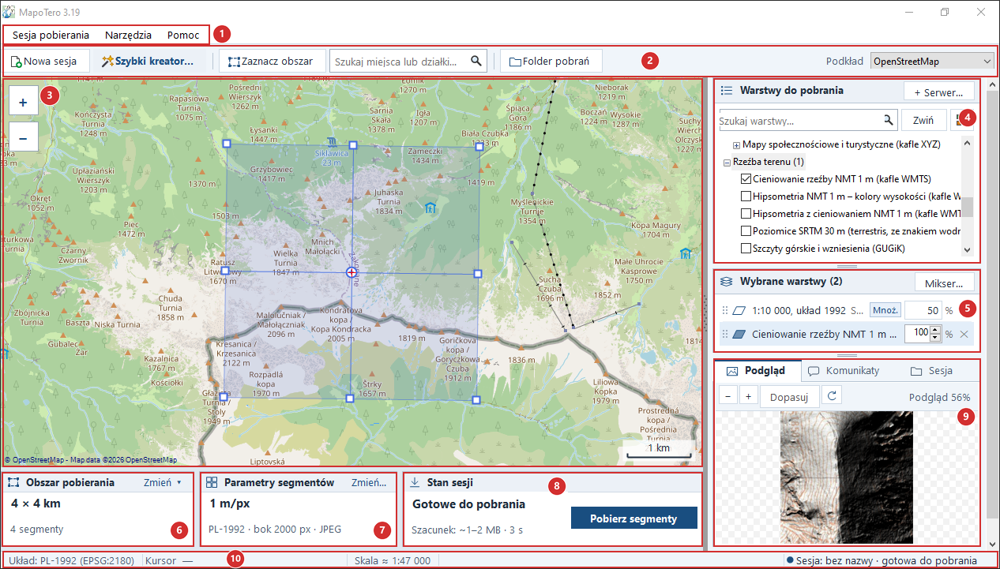
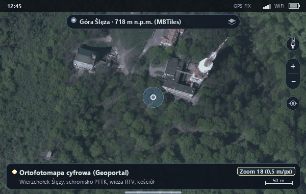
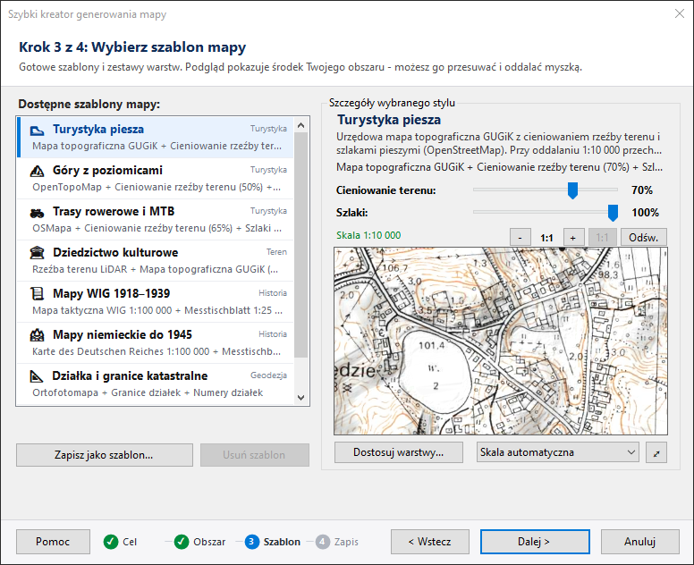
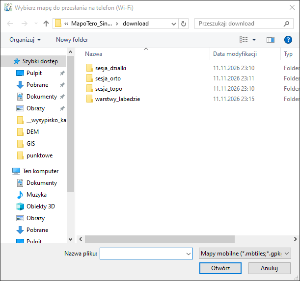
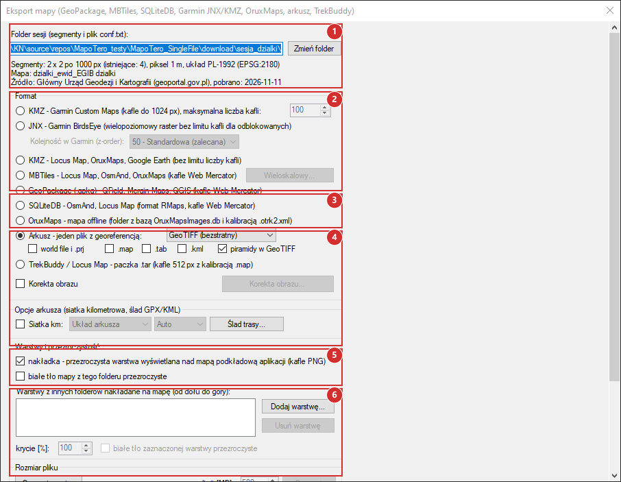
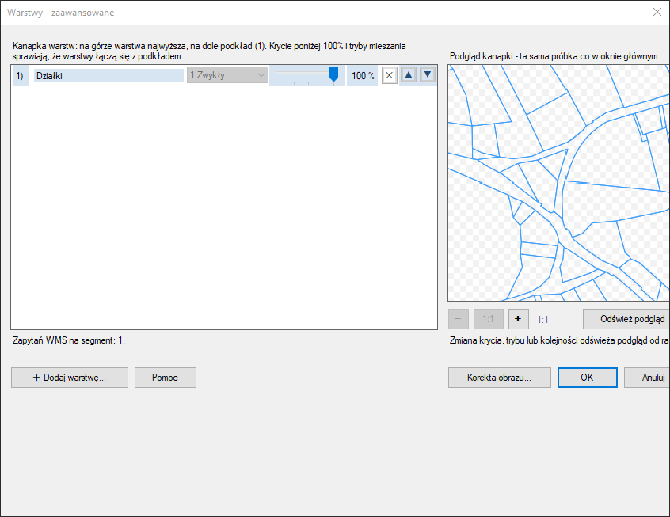

# MapoTero

[](LICENSE)
[](https://dotnet.microsoft.com/)
[](https://github.com/Eksploracja/MapoTero/actions/workflows/kompilacja.yml)
[](https://github.com/Eksploracja/MapoTero/releases)
[](https://eksploracja.github.io/MapoTero/pomoc/)
[](https://www.facebook.com/mapotero.opensource)
[](https://buycoffee.to/mapy)

**MapoTero** to darmowy, otwartoźródłowy program dla systemu Windows do pobierania map rastrowych z usług **WMS, WMTS oraz XYZ/TMS**. Pozwala pobrać ortofotomapy, cieniowanie LiDAR/NMT, mapy topograficzne, historyczne i ewidencję działek (EGiB) → gotowe mapy offline na telefon, odbiorniki Garmin, do programów GIS oraz rysunków CAD.

[Pobierz](#pobieranie-i-wymagania) · [Szybki start](#szybki-start) · [Galeria warstw](https://eksploracja.github.io/MapoTero/pomoc/galeria-warstw/) · [Podręcznik online](https://eksploracja.github.io/MapoTero/pomoc/) · [Zgłoś błąd](https://github.com/Eksploracja/MapoTero/issues)



## Co zrobisz w MapoTero?

| Zastosowanie | Formaty wyjściowe | Przykładowe aplikacje i urządzenia |
| --- | --- | --- |
| **Mapy offline w telefonie** | MBTiles (także wielowarstwowe i wieloskalowe), OGC GeoPackage (`.gpkg`), SQLiteDB, OruxMaps | Locus Map, OsmAnd, OruxMaps, QField, Mergin Maps, Avenza Maps |
| **Odbiorniki Garmin** | Garmin BirdsEye (`.jnx` bez limitu 100 kafli), Garmin Custom Maps (`.kmz` z `z-order`, dzieleniem na tomy i przezroczystym PNG) | Urządzenia Garmin (bezpośredni zapis przez USB) |
| **Praca w GIS i wydruki** | Kafelkowany GeoTIFF z piramidą pomniejszeń (COG), scalony JPEG / PNG oraz pojedyncze segmenty z georeferencją | [QGIS](https://www.qgis.org/), ArcGIS, [Google Earth](https://www.google.pl/intl/pl/earth/) |
| **Podkłady do CAD** | Rysunek DXF (R2000) z obrysem, siatką i numeracją, skrypt SCR oraz program LISP (`.lsp`) | AutoCAD, AutoCAD LT, BricsCAD, ZWCAD |



*Przykład działania mapy wieloskalowej w telefonie: jedna baza MBTiles lub GeoPackage automatycznie przełącza mapy wraz ze zmianą powiększenia (od skali 1:50 000 przez 1:25 000 i 1:10 000 po cieniowanie rzeźby LiDAR i ortofotomapę wysokiej rozdzielczości).*

### Najważniejsze możliwości

* **Mapy wieloskalowe w jednym pliku:** jedna baza MBTiles lub GeoPackage zastępuje kilka osobnych map – w telefonie przybliżasz, a mapa automatycznie przełącza się z widoku ogólnego na szczegółowe topo, cieniowanie rzeźby LiDAR i ortofotomapę wysokiej rozdzielczości.
* **Szybki kreator map (`Ctrl+K`):** w 4 krokach prowadzi od wyboru urządzenia i gotowego stylu mapy do gotowego pliku offline.
* **Transfer na telefon przez Wi-Fi i kod QR:** bez kabla USB i bez zewnętrznej chmury. Wystarczy zeskanować kod QR aparatem telefonu, aby pobrać mapę bezpośrednio przez sieć lokalną.
* **Własne kompozycje warstw:** łączenie warstw z różnych serwerów (WMS, WMTS i XYZ razem), regulacja krycia, tryby mieszania (w tym tryb *7 Rzeźba terenu* dla cieniowania LiDAR) oraz podgląd efektu na żywo przed pobieraniem.
* **Pobieranie tylko potrzebnego obszaru:** siatka segmentów (do 2048×2048 px) z przesuwanymi uchwytami, korytarz wzdłuż trasy GPX/KML/KMZ, obrys z pliku `.gpkg` oraz wyszukiwarka miejscowości, adresów i działek ULDK (`Ctrl+F`).
* **Układy współrzędnych i konwertery:** precyzyjne przeliczenia w locie dla PL-1992, PL-2000 (strefy 5–8), UTM (33N–35N) i WGS84 oraz wbudowany konwerter starych map OziExplorer (`.map`) do formatów JNX, KMZ i MBTiles.

## Pobieranie i wymagania

Program działa w trybie **portable (bez instalacji)** jako pojedynczy plik `MapoTero.exe`, dostarczany w archiwum ZIP wraz z katalogiem `warstwy` (definicje zbiorów map) oraz plikiem `CZYTAJTO.txt`:

* 📥 **[Pobierz najnowszą wersję MapoTero (ZIP, Windows 64-bit)](https://github.com/Eksploracja/MapoTero/releases/latest):** pobierz i rozpakuj archiwum ZIP, a następnie uruchom `MapoTero.exe` (folder `warstwy` musi znajdować się obok pliku `.exe`).
* 📦 **[Wszystkie wydania, kody źródłowe i historia zmian (GitHub Releases)](https://github.com/Eksploracja/MapoTero/releases):** pełne archiwum wydań oraz sumy kontrolne SHA-256.
* 📖 **[Podręcznik użytkownika online](https://eksploracja.github.io/MapoTero/pomoc/):** 42 rozdziały instrukcji krok po kroku z opisem narzędzi, formatów i konfiguracji.

**Wymagania systemowe:**
* System Windows (64-bitowy).
* Środowisko uruchomieniowe **[.NET Desktop Runtime 10 (x64)](https://dotnet.microsoft.com/download/dotnet/10.0)** (jeśli nie jest zainstalowane, Windows zaproponuje jego automatyczne pobranie przy pierwszym uruchomieniu).

> [!NOTE]
> **Pierwsze uruchomienie w systemie Windows (komunikat SmartScreen)**  
> MapoTero jest darmowym projektem otwartoźródłowym (GPLv3) i nie posiada płatnego podpisu cyfrowego, dlatego Windows może przy pierwszym uruchomieniu wyświetlić niebieski ekran *„System Windows ochronił ten komputer”*.  
> * **Jak uruchomić:** kliknij **„Więcej informacji”**, a następnie **„Uruchom mimo to”**.  
> * **Szybszy sposób (przed rozpakowaniem):** kliknij prawym przyciskiem myszy na pobranym pliku ZIP → **Właściwości** → zaznacz **„Odblokuj”** u dołu okna → **OK**.  
> * **Weryfikacja pliku:** w opisie każdego [wydania w Releases](https://github.com/Eksploracja/MapoTero/releases/latest) znajdziesz sumy kontrolne SHA-256 archiwum ZIP i `MapoTero.exe` oraz link do skanu w serwisie VirusTotal.

<details markdown="block">
<summary><b>Zobacz jak wygląda monit SmartScreen (zrzut ekranu)</b></summary>


</details>

## Szybki start

### Opcja A: Szybki kreator map (polecana na start)

1. Uruchom program i naciśnij **`Ctrl+K`** (lub wybierz *Szybki kreator map* z menu/paska).
2. Wybierz urządzenie docelowe (smartfon, Garmin KMZ/JNX, wydruk A4–A0 lub CAD/GIS) oraz gotowy styl mapy (np. turystyka, góry, rower, cieniowanie LiDAR z zabytkami NID, mapy historyczne lub działki EGiB).
3. Wskaż obszar na mapie i zatwierdź. Program pobierze dane i wygeneruje gotowy plik, który możesz od razu przesłać na telefon kodem QR lub skopiować na odbiornik Garmin przez USB.



### Opcja B: Tryb ręczny (pełna kontrola nad warstwami)

1. **Wybierz mapy i warstwy:** w drzewie *Wybierz mapy* po prawej stronie rozwiń grupę tematyczną (lub użyj pola *szukaj warstwy…*) i zaznacz warstwy. Pierwsza wybrana warstwa stanowi podkład, a kolejne nakładają się na nią. Możesz łączyć warstwy z różnych serwerów (WMS, WMTS i XYZ).
2. **Ustaw kolejność i krycie:** w panelu *Wybrane warstwy oraz ich kolejność* zmień kolejność przyciskami `▲` `▼` lub przeciągając myszą, dostosuj krycie albo kliknij `…`, aby otworzyć okno zaawansowane z trybami mieszania i podglądem na żywo.
3. **Zaznacz obszar:** prawym przyciskiem myszy zaznacz zasięg na mapie, wyszukaj miejscowość lub działkę (`Ctrl+F`) albo przeciągnij na okno plik trasy GPX/KML/KMZ (lub poligon `.gpkg`), aby wyznaczyć korytarz wzdłuż trasy.
4. **Pobierz segmenty:** kliknij **„Pobierz”**. Pliki trafią do osobnego podfolderu sesji wewnątrz katalogu `download` (ponowne kliknięcie wznawia sesję i dociąga wyłącznie brakujące segmenty).
5. **Wyeksportuj lub scal mapę:**
   * **Telefon, Garmin lub scalony arkusz:** otwórz *Narzędzia > Eksport mapy* (`Ctrl+E`), aby zapisać mapę jako MBTiles, OGC GeoPackage (`.gpkg`), Garmin JNX/KMZ, SQLiteDB, OruxMaps albo scalony arkusz *GeoTIFF / JPEG / PNG* (format *Arkusz*). Z tego okna możesz także wysłać plik na telefon przez **Wi-Fi (kod QR)** lub zapisać prosto na podłączony **Garmin USB**.
   * **Programy CAD:** wybierz *Narzędzia > Eksport do CAD*, aby utworzyć rysunek DXF, skrypt `SCRIPT` (`.scr`) lub program LISP (`APPLOAD`) wstawiający mapę na warstwy `MAPOTERO_...` (przy dużej liczbie segmentów skorzystaj w tym oknie z przycisku *Scal segmenty…*).



<details markdown="block">
<summary><b>Więcej zrzutów ekranu (Eksport mapy, kompozycje warstw z cieniowaniem LiDAR)</b></summary>

### Eksport mapy (formaty mobilne, arkusze GeoTIFF, Garmin USB)


### Kompozycje warstw, krycie i rzeźba terenu (LiDAR)


</details>

## Obsługiwane źródła map (WMS, WMTS, XYZ/TMS)

Program zawiera bogaty zestaw wbudowanych warstw pogrupowanych tematycznie oraz **kreator serwerów (`[+]`)** z katalogiem ponad 100 sprawdzonych usług publicznych, wyszukiwarką rejestru EZiUDP i możliwością dodania dowolnego własnego adresu WMS, WMTS lub XYZ/TMS.

Dostępne źródła map możesz także wygodnie przeglądać i dodawać do programu bezpośrednio z internetowej **[Galerii warstw](https://eksploracja.github.io/MapoTero/pomoc/galeria-warstw/)**.

Główne wbudowane źródła danych:

* **Geoportal (GUGiK):** ortofotomapy, TrueOrtho, skany map topograficznych, BDOT10k, cieniowanie i hipsometria NMT/LiDAR, ewidencja gruntów (EGiB), uzbrojenie terenu (KIUT/K-GESUT), granice i adresy (PRG).
* **Państwowy Instytut Geologiczny (PIG-PIB):** mapy geologiczne, regiony fizycznogeograficzne, osuwiska i jaskinie.
* **Generalna Dyrekcja Ochrony Środowiska (GDOŚ):** formy ochrony przyrody.
* **Narodowy Instytut Dziedzictwa (NID) i Instytut Historii PAN (IHPAN):** zabytki, pomniki historii, cmentarze wojenne oraz bogaty zbiór map historycznych (m.in. WIG 1:25k/1:100k, niemieckie mapy topograficzne, mapy XVIII–XX w., plany historyczne miast).
* **Mapy kafelkowe XYZ/TMS:** OSMapa.pl, UMP-pcPL, szlaki Waymarked Trails (piesze, rowerowe, MTB i inne), OpenTopoMap oraz usługi z katalogu QuickMapServices.
* **Służby geodezyjne krajów sąsiednich i Bałtyku:** Czechy (**ČÚZK**), Słowacja (**ZBGIS**, **Freemap**), Niemcy (**BKG**, **GeoBasis-BB Brandenburgia**, **GeoSN Saksonia**), Litwa (**INSPIRE**) oraz **EMODnet Bathymetry**.

<details markdown="block">
<summary><b>Wskazówki dla map w strefie przygranicznej (Czechy, Słowacja, Niemcy, Litwa)</b></summary>

* **Dobór układu współrzędnych:**
  * **Warstwy WMTS i XYZ** (np. czeska *ZTM_WM*, słowacka *Freemap Outdoor*, niemiecka *basemap.de*, *OpenTopoMap*): działają w każdym układzie (PL-1992, PL-2000, UTM, WGS84), ponieważ program przelicza je w locie na siatkę wybranego układu.
  * **Warstwy czystego WMS** (szczegółowe skany czeskie *ZTM 10/25/50*, słowackie *ZM10/25/50*, brandenburskie *DTK10/25/50*): serwery te nie obsługują polskiego układu PL-1992. Wybierz dla nich w oknie głównym układ **WGS84 (EPSG:4326)** lub strefę **UTM 33N/34N** (Saksonia dodatkowo wspiera bezpośrednio PL-1992).
* **Łączenie na granicy bez białych plam:**
  * Gdy zagraniczny serwer wypełnia obszar poza granicą białym kolorem zamiast przezroczystości (np. Saksonia lub Brandenburgia), w oknie *Warstwy zaawansowane* (przycisk `…`) zmień tryb mieszania górnej warstwy na **Mnożenie (Multiply)**. Biel stanie się niewidoczna, a drogi, warstwice i napisy obu map płynnie się połączą.

</details>

> [!TIP]
> **Własne zbiory map:** zaawansowani użytkownicy mogą dodawać i organizować własne pliki definicji warstw w katalogu `warstwy/` oraz konfigurować strukturę grup w pliku `katalog.txt`. Szczegółowy opis formatów znajdziesz w [Podręczniku online](https://eksploracja.github.io/MapoTero/pomoc/warstwy/).

<details markdown="block">
<summary><b>Budowanie ze źródeł i kompilacja (dla programistów)</b></summary>

**Wymagania:** **Visual Studio 2026 (18.0+)** z obsługą .NET 10 albo samo **.NET 10 SDK** (*Visual Studio 2022 nie kompiluje projektów .NET 10*).

**Struktura rozwiązania (`MapoTero.sln`):**
* `MapoTero.App`: aplikacja desktopowa (Windows Forms),
* `MapoTero.Core`: obliczenia geodezyjne, obsługa usług i formatów plików,
* `MapoTero.Silnik`: potok obrazów, nakładanie warstw, scalanie i eksport map,
* `MapoTero.Tests`: testy jednostkowe,
* `warstwy`: definicje zbiorów map i katalog warstw.

**Kompilacja, testy i publikacja jednego pliku `MapoTero.exe`:**

Program wydawany jest wyłącznie jako pojedynczy plik `MapoTero.exe` (projekt nie pozwala na publikację wersji wieloplikowej). Polecenie `dotnet publish` tworzy katalog `MapoTero_SingleFile` z plikiem `MapoTero.exe`, folderem `warstwy` i plikiem `CZYTAJTO.txt`:

```powershell
# Sprawdzenie kompilacji (katalog bin zawiera tylko pliki pośrednie)
dotnet build MapoTero.App/MapoTero_v3.vbproj -c Release

# Uruchomienie testów jednostkowych
powershell -NoProfile -File MapoTero.Tests/uruchom.ps1

# Publikacja jednoplikowego wydania
dotnet publish MapoTero.App/MapoTero_v3.vbproj -c Release -o MapoTero_SingleFile
```

Każda zmiana w repozytorium jest automatycznie budowana i testowana w **GitHub Actions**. Aktualną kompilację testową (`MapoTero.exe` + `warstwy` + `CZYTAJTO.txt`) można pobrać jako artefakt *MapoTero* w zakładce **Actions**.

</details>

## Dokumentacja, społeczność i wsparcie

* 📖 **[Podręcznik użytkownika online](https://eksploracja.github.io/MapoTero/pomoc/):** pełna dokumentacja okien, narzędzi i formatów oraz poradniki dla aplikacji mobilnych i CAD.
* 🌐 **[Internetowa Galeria warstw](https://eksploracja.github.io/MapoTero/pomoc/galeria-warstw/):** katalog gotowych źródeł map z podglądem i możliwością bezpośredniego dodania do programu.
* 🐛 **[Zgłaszanie błędów i propozycji (GitHub Issues)](https://github.com/Eksploracja/MapoTero/issues):** miejsce na raporty usterek i pomysły na nowe funkcje.
* 👥 **[Oficjalny profil na Facebooku](https://www.facebook.com/mapotero.opensource):** aktualności, informacje o wydaniach i ciekawostki.
* 💬 **[Pomorskie Forum Eksploracyjne](https://forum.eksploracja.pl/viewforum.php?f=205):** dyskusje i wsparcie techniczne w dziale *„Programy GPS/GIS wspierające eksplorację”*.
* 🤝 **Współtworzenie zbiorów map:** znasz ciekawy serwer WMS/WMTS albo chcesz poprawić/dodać warstwę? Zgłoś Issue lub wyślij Pull Request z nowym plikiem w katalogu `warstwy/`.
* ☕ **[Wesprzyj rozwój projektu (buycoffee.to/mapy)](https://buycoffee.to/mapy):** postaw kawę autorowi (link dostępny także w menu *Pomoc* w programie).

## Zespół projektu

* **Twórca programu:** Pajakt (2009–2014)
* **Rozwój projektu:** [Kazimierz Niecikowski](https://www.labgis.pl/) (od 2015)
* **Współpraca programistyczna:**
  * Paweł\_gdn
  * AAA222 (moduł NoTo, scalanie segmentów do wersji 3.11)
  * Edward Zadorski (kod modułu przeliczania współrzędnych)

## Licencja

Program jest wolnym oprogramowaniem udostępnianym na warunkach licencji **GNU General Public License v3 (GPLv3)**. Szczegóły znajdują się w pliku [LICENSE](LICENSE).
